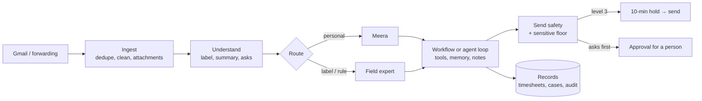

<div align="center">

# 📮 Post Room

### The sorting office for your email

**A personal AI agent for your inbox.** Post Room reads every email, understands what it needs, and hands it to the
right helper on your team. Helpers draft, file, record and follow up, and they earn the freedom to act on their own.
A guard checks every outgoing action, and the audit trail keeps a record of it.

[Live app](https://mail.anukulraj.tech) · [Features](docs/features.md) · [Architecture](docs/architecture.md) ·
[Learn the codebase](docs/learn/README.md) · [Task list](docs/TASKS.md)


</div>

---

## Why Post Room

Email is where work arrives: leave requests, timesheets, client requirements, invoices, support questions, meeting
asks. Most of it is routine, but each email still needs someone to read it, decide, write back and keep a record.

Post Room is **"Muse for email"**: every person gets **Meera**, a personal agent that knows their mailbox, their voice
and their preferences. Behind Meera sits a small team of **field experts**, one per area of work, each with an
Indian name and a clear job.

| | Helper | Does |
|---|---|---|
| 🙋 | **Meera** | Your personal agent and the "Ask Meera" chat; routes everything else |
| 🌴 | **Ananya** | Leave requests: restates dates and type, prepares the manager's decision |
| ⏱ | **Rohan** | Timesheets: reads pasted tables, Excel and PDF, and records them for the right person. Never replies |
| 🧭 | **Sneha** | Onboarding: collects joining documents, keeps the checklist moving |
| 🧩 | **Arjun** | Client requirements and candidates: shortlists, asks before submitting |
| 💼 | **Aditya** | Payroll questions: acknowledges, never states amounts, always asks first |
| 🎧 | **Ishaan** | Customer support |
| 🎯 | **Kabir** | Sales enquiries and follow-ups |
| 🧾 | **Vikram** | Invoices and payments (always asks) |
| 📅 | **Nisha** | Meeting requests and scheduling |

Helpers come in **packs** you switch on at sign-up: General, Support, Sales, Finance, Personal, and HR & recruiting.
You can also describe a new helper in plain English, and the **builder** writes it, tests it on a dry run, and warns
you if it overlaps someone who already does that job.

## What it does

<table>
<tr><td width="50%" valign="top">

**📥 Understands every email**
- A Gmail-style reader with search by words *and* meaning
- Labels that follow your packs
- Reads attachments as text: Excel, CSV, Word, PowerPoint, PDF, images (OCR), audio
- Summaries in plain language, with amounts in ₹

</td><td width="50%" valign="top">

**✍️ Replies like you**
- Drafts in the mailbox owner's voice, never signed by an agent
- One-click **Send** with a **30-second Undo**
- Send safety: right recipient, no leaks, no duplicate sends
- Learns from your edits, with a guard on what it learns

</td></tr>
<tr><td valign="top">

**🤝 A team that earns trust**
- Autonomy levels 0 → 3, with a 10-minute hold before sends
- A **sensitive floor** that always asks: salary, bank details, offers, legal, IDs
- Approvals tied to a content hash; Stop and Pause-all at any time
- Automatic demotion when quality slips

</td><td valign="top">

**🗂 HR built in (HR & recruiting pack)**
- People, billable rules, submissions, escalations
- **Team timesheet grid**: people × days, totals, Missing / Needs check, CSV export
- Matching of candidates to client requirements
- Month-end reminders up the escalation chain

</td></tr>
<tr><td valign="top">

**🛡 Safe by design**
- Prompt-injection gate on everything that comes in by email
- Workspace isolation tested on every route
- A full audit trail of every action
- Delete stays inside Post Room (Gmail keeps its copy); disconnect deletes everything after a confirm

</td><td valign="top">

**📈 Measured, not guessed**
- 95 golden scenarios with a scorecard per agent
- AI health page: incidents, cost and latency spikes
- A ledger of every AI call, with daily budgets
- A daily self-test that emails the owner on failure

</td></tr>
</table>

## How it works



Every stage writes its result and enqueues the next job **in one SQLite transaction** (`BEGIN IMMEDIATE`). A Tokio
worker runs the jobs with leases, retries and a dead-letter list. Routing is a pure function: no AI call, so it is
fast, cheap and testable. Read [docs/architecture.md](docs/architecture.md) for the full picture.

## Tech stack

| Layer | Choice | Why |
|---|---|---|
| API | **Rust**, Axum, SQLx, Tokio | Fast, memory-safe, one small binary |
| Data | **SQLite** in WAL mode, FTS5, sqlite-vec | One file, no DB server, full-text and vector search |
| Jobs | A SQLite `jobs` table + Tokio worker | Durable queue without extra infrastructure |
| Web | **React**, TypeScript, Vite, TanStack Query, Tailwind | |
| AI | OpenRouter (cheap models for routine work, stronger ones only when needed), Jev for classification | Cost per email in paise, not rupees |
| Mail | Gmail through Nango, forwarding through Resend | |
| Deploy | GitHub Actions → GHCR image → VPS behind Caddy | Every push to `main` is tested, then deployed |

## Quick start

Needs Rust (stable) and Node 24 + pnpm.

```bash
cp .env.example .env     # AUTH_MODE=password; for a dev login set AUTH_MODE=dev + ALLOW_DEV_AUTH=1
make api                 # API + worker on :8080 (runs migrations on start)
make web                 # second terminal → http://localhost:5173
```

Without AI keys it still runs: rules for labels, templates for drafts. Add `OPENROUTER_API_KEY` for the real thing.
Setup for Gmail (Nango), forwarding (Resend) and production: [docs/setup-and-design.md](docs/setup-and-design.md).

## Tests and evals

```bash
cd apps/api
cargo test                       # unit + integration: ~895 tests, about 2 minutes on an M4
cargo test --test api -- timesheet_records::     # just one area
cargo clippy --all-targets -- -D warnings
cd ../web && pnpm typecheck && pnpm vitest run   # ~306 web tests
```

The integration tests run as **one test binary** that starts each test from a pre-migrated template database, so a
full run takes about 2 minutes instead of 11. Golden evals and the live model baseline:
[docs/evals.md](docs/evals.md). The scorecard history is in [docs/evals/scorecard.md](docs/evals/scorecard.md).

## Repository map

```
apps/api        Rust API + worker (Axum, SQLx, SQLite)
apps/web        React app
docs/           product, architecture, API contract, evals, learning path
scripts/        live test pack (dummy emails per workflow + checker)
.github/        CI: lint, tests, e2e, image, deploy, daily self-test
```

## Documentation

| Read | For |
|---|---|
| [docs/features.md](docs/features.md) | Everything the product does today |
| [docs/architecture.md](docs/architecture.md) | How it fits together |
| [docs/api.md](docs/api.md) | The REST contract |
| [docs/learn/](docs/learn/README.md) | A 9-module course on this codebase: Rust, architecture, tools, AI + email, agents, evals |
| [docs/product-engineering/](docs/product-engineering/README.md) | The engineering audit: defects, cost, security, test speed |
| [docs/TASKS.md](docs/TASKS.md) | The ordered task list, with [ready-to-paste prompts](docs/TASK-PROMPTS.md) |
| [docs/status-2026-10-15.md](docs/status-2026-10-15.md) | An honest status: what's live, what isn't yet |

## Status

Live at [mail.anukulraj.tech](https://mail.anukulraj.tech) for a first workspace. Safety on golden scenarios is
clean (0 safety failures in the live baseline). The open work, in order, is in [docs/TASKS.md](docs/TASKS.md): faster
CI, a feature-first code structure, job-queue hardening, the planner loop, then cheaper understanding and members
connecting their own Gmail.

<div align="center"><sub>Built with Rust, React and a lot of careful email handling.</sub></div>
