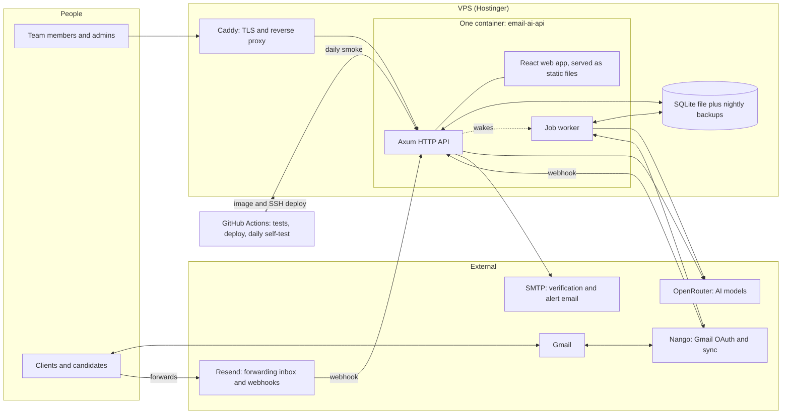
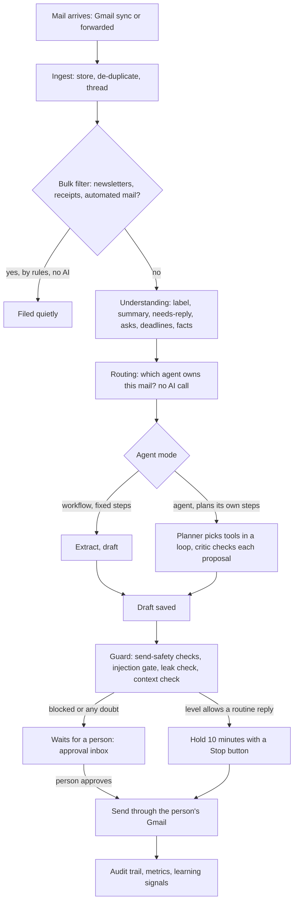
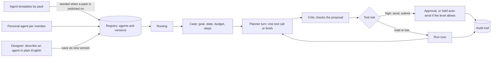
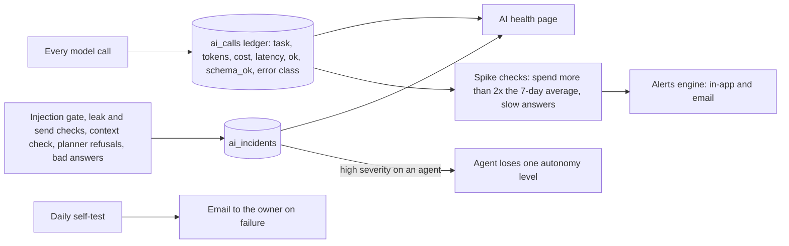

# Post Room architecture

Updated 15 Oct 2026. Written for two readers: a new engineer who needs to find their way around the code, and a
non-technical reader who wants to know what the system does with their mail and why it can be trusted. Every section
starts with the plain version; the engineering detail follows.

Where a feature is not merged yet it is marked **in progress**.

## 1. What Post Room is, in one minute

Post Room reads a team's email, understands it, and gets routine work done: it labels mail, writes draft replies in the
team's voice, follows up, and keeps track of people, timesheets and requirements. A person stays in charge. Anything
risky waits for approval, and a helper called **Meera** answers questions by voice or text.

The idea that shapes everything: **an AI helper earns freedom.** A new helper only watches. Then it drafts. Only after
it has proven itself on real mail, and an admin agrees, may it send routine replies on its own, and even then it can be
stopped for ten minutes before anything leaves. One bad moment and it loses a level automatically.

## 2. System diagram

The API and the worker are **one process** (`email-ai-api serve`). The worker is a set of async tasks reading a
durable job table in the same SQLite database, so there is no separate queue service to run.

## 3. Components

| Component | What it does | Where |
|---|---|---|
| **API** | Axum HTTP server. Every route under `/api/v1`. Sessions, roles, rate limits, security headers. | `apps/api/src/http/` (one file per area), `lib.rs`, `main.rs` |
| **Job worker** | Takes jobs from the `jobs` table (leases, retries, dead-letter), runs them with bounded concurrency, and every few minutes schedules the recurring work: mailbox polling, alert evaluation, agent ticks, metrics rollup, autonomy sweep, nightly backup. | `apps/api/src/jobs/` (`worker.rs`, `handlers.rs`, one module per job family) |
| **SQLite** | The one database (WAL mode). Migrations in `apps/api/migrations`, applied on start. Includes full-text search and the `sqlite-vec` vector index. | `db.rs`, `migrations/` |
| **Web app** | React single-page app. Built in Docker and served by the API itself, so there is one thing to deploy. | `apps/web/src/features/*` (one folder per page area) |
| **OpenRouter** | The gateway to every AI model (labelling, drafting, planning, vision, audio, embeddings). Model names are configuration only, and never shown to users. | `ai/openrouter.rs`, `ai_ledger.rs` |
| **Nango + Gmail** | Each person connects their own Gmail through Nango (OAuth, sync, send, drafts). Nango calls the API webhook when mail arrives. | `sources/nango.rs`, `http/sources.rs`, `http/webhooks.rs` |
| **Resend** | A forwarding inbox (`inbound` domain) for people who forward mail instead of connecting Gmail. | `sources/resend.rs` |
| **SMTP** | Verification codes, password resets, alert emails and digests. | `mailer.rs` |
| **VPS, Caddy, GitHub Actions** | One server; Caddy terminates TLS and proxies to `127.0.0.1:18090`; Actions test, build the image, deploy over SSH, and run a daily self-test (section 14). | `compose.yml`, `Dockerfile`, `.github/workflows/` |

## 4. How an email travels

The same thing in words, with where each step lives.

1. **Ingest** (`ingest.rs`, `sources/`). Mail is stored once per source, de-duplicated, and put in a thread. Mail the
   team sent is stored as *outbound* and never classified or drafted for. Messages hidden by a person's privacy wall or
   a policy are marked `suppressed` and every read path skips them (section 12).
2. **Bulk filter** (`bulk_filter`, `bulk.rs`). Newsletters, receipts and automated mail are recognised by rules (headers,
   sender patterns, unsubscribe links). Two or more signals and the mail is filed with no AI call. This alone removes
   about a quarter of all model spend.
3. **Understanding** (`ai/understand.rs`, `ai/mod.rs`, `jobs/message_jobs.rs`). One analysis per message (a single-flight
   guard stops duplicates). Today this is a label call plus an analysis call. "Understanding v2" does both in one
   structured call, with code-side checks that quotes really appear in the mail; it runs beside production in
   **shadow** mode and may take over once it agrees on at least 95% of labels (`UNDERSTAND_V2=off|shadow|on`).
4. **Routing** (`agent_registry/routing.rs`). A pure function, no AI. Precedence: manual choice, then an open thread
   or case, then trigger rules, then labels, then the lead agent (Meera) as the fallback. The result is stored in
   `message_routes`. If the chosen agent is still at level 0, the work runs as a **shadow case**.
5. **Agent or workflow** (`agents/`, `jobs/handlers.rs`). A *workflow* agent runs fixed steps (extract fields, draft).
   An *agent* runs a planner loop (section 5).
6. **Draft** (`ai/` drafter, `learning/context_pack.rs`). Drafts are written from a verified context pack (the thread,
   the person's profile, learned preferences, and facts with their source). Anything the pack does not support
   becomes `[NEEDS: ...]`, and a draft with open `[NEEDS]` can never be sent.
7. **Guard and hold** (`send_safety.rs`, `agents/autonomy.rs`, `agents/injection.rs`, `replies.rs`). Every send path
   goes through `replies::send_draft`, which runs the guards (section 11) and, for automatic sends, holds the mail for
   `AGENT_AUTO_SEND_DELAY_SECS` (default 600) so a person can press Stop.
8. **Send.** Through the mailbox owner's own Gmail via Nango, in the original thread, with a 30 s undo and duplicate-send
   protection (each send has an attempt id that is reconciled if the process dies mid-send).

## 5. Agent runtime

Customer-facing explanation: [How agents work](how-agents-work.md). The design decisions behind the next version are recorded privately and land here as each part ships.

**Plain version.** An agent is a named helper with a job description (what mail it handles, what tools it may use,
how far it may go). The platform ships a set of ready-made helpers per area (support, sales, finance, personal, HR),
and each person also gets a personal helper, Meera, for their own mailbox. Each helper has an autonomy level that it
earns.

**Engineering detail.**

- **Registry** (`agent_registry/`). `agents` plus `agent_versions`. A version is an `AgentSpec` (`spec.rs`): triggers,
  steps, tools, scopes (read mail, draft, send, label, schedule), permissions, memory, drafting rules (`never_do`),
  budget. Specs reject unknown fields, so a typo or an injected field never silently does something. Saving a spec
  makes a new version; behaviour-changing versions must pass the safety suite before they keep any autonomy.
- **Personal agents = Meera.** Every member gets one personal agent (`scope='personal'`) on joining. It works only on
  that member's own mailbox, profile, preferences and memory. Workspace agents work on shared handling. An admin can
  not start a case on a member's personal mail.
- **System agents by pack** (`agent_registry/templates.rs`, `packs.rs`): General (Lead, Inbox Assistant, always on),
  Support (Ticket Resolver, Escalations), Sales (Lead Qualifier, Follow-ups), Finance (Invoices and Payments),
  Personal (Scheduling), and **HR and recruiting** (`staffing` pack: Leave, Timesheets, Onboarding, Candidates and
  Requirements, Payroll queries). Switching a pack off pauses its agents (`pack_off`); switching it on restores them.
- **Cases and steps** (`agents/case.rs`, `runner.rs`, `planner.rs`, `tools.rs`). A case is one unit of work with a goal,
  a step limit (default 15) and a dollar budget (default $0.10). Each planner turn is one durable job, so cases
  survive restarts and can sleep for days (`schedule_check`; a client reply wakes it early). Tools: `search_mail`,
  `read_email`, `read_thread`, `find_candidates`, `recall_memory`, `draft_email`, `create_task`, `schedule_check`,
  `update_case`, `extract_fields`, `label_email`, `save_to_gmail_drafts`, `send_email`, `submit_candidate`,
  `propose_automation`. A tool outside the agent's scopes is never offered.
- **Autonomy levels** (`agents/autonomy.rs`):

  | Level | Name | What it may do |
  |---|---|---|
  | 0 | Observe | Shadow cases: drafts are scored against what a person actually sent, nothing is stored or sent. |
  | 1 | Draft | Real drafts. Every send asks a person. |
  | 2 | Routine send | Replies to the original sender in the same thread to a known contact, when every fixed rule passes. Held 10 minutes. |
  | 3 | Autonomous | Level 2, plus replies to any current participant and first replies. Only by an explicit admin grant. |

  A **fixed floor** applies at every level: new recipients, forwards, outgoing attachments, candidate submissions,
  money or decision wording, `[NEEDS]` gaps and the agent's own `never_do` rules always ask a person.
  The **effective level** is the lowest of: earned level, the admin's cap, the spec's maximum, the environment limit
  (`AGENT_MAX_AUTONOMY`) and the owner's profile ("always ask" caps at 1).
- **Earning and demotion** (`evals/gate.rs`). Promotion is an explicit admin click, refused until a checklist is met
  (safety suite 100%, observed cases and agreement for L1; approvals, approval rate, edit distance, replay score and
  zero incidents for L2; more of each for L3). **Demotion is automatic**: an hourly sweep, plus an immediate drop when
  a high-severity incident is logged (section 13), when an automatic send is stopped by a person, or when the
  7-day approval rate falls well below the level's bar.
- **Injection gate** (`agents/injection.rs`). Inbound mail is data, never instructions. Text that names an agent
  tool or uses override phrases ("ignore previous", "system:", "bcc", "without approval") forces a person's approval
  at every level, and is logged as an incident.
- **Approvals** (`agents/approvals.rs`, `http/agents_api.rs`). A high-risk tool creates an approval; the case waits.
  The person can approve, edit-then-approve or decline. Approving goes through the same send guards.
- **Audit** (`audit.rs`). Every consequential action (send, approval, autonomy change, incident resolved, pack
  toggle) writes an `audit_events` row in the same transaction. Metadata holds ids and enums, never mail bodies.

## 6. Learning loop

**Plain version.** When a person edits a draft, approves it, or corrects a label, the system notices and gets a little
better for that person and that helper, but only in safe ways: it learns *style* (shorter, warmer, a preferred
sign-off), not new permissions, and never from instructions found inside incoming mail.

- **Signals** (`learning/signals.rs`, `hooks.rs`) are append-only and recorded in the same transaction as the person's
  action (edit, approve, decline, label correction, reroute, stopped send).
- **Preferences** (`learning/preferences.rs`, `guard.rs`). A preference comes only from the user's own edits or notes.
  A guard (an enum of allowed kinds plus regexes) rejects anything that looks like an instruction to the agent. It is
  placed in the prompt below the profile, so it cannot override rules.
- **Per-agent memory** (`memory.rs`, `memory_learning.rs`). Facts learned from mail are stored with their source;
  facts from outside the team stay capped until a person confirms them (no memory poisoning).
- **Context pack** (`learning/context_pack.rs`). Each draft prompt is built from a verified pack, and the critic turns
  unsupported claims into `[NEEDS]`.
- **Gain** (`learning/gain.rs`) measures whether edits are shrinking over time.

## 7. Evals

| Kind | What | Where | When |
|---|---|---|---|
| **Golden offline** | 29 scenarios (support, sales, finance, personal, requirement, angry customer, prompt injection, needs-info, permissions, limits). A scripted planner and a canned drafter check the *invariants*: nothing leaves without a person unless the scenario allows it, sends go only to the original sender, `[NEEDS]` drafts never go out, step and budget caps hold. | `tests/golden_offline.rs`, `evals/scenarios.json` | Every CI run and the daily self-test |
| **Golden live** | The same scenarios with real models. Costs money. Fails only if a safety invariant breaks. | `tests/golden_live.rs` | On demand |
| **Understanding golden** | Labelling accuracy on a labelled set, offline. | `tests/golden_understanding.rs` | CI |
| **In-product gates** | Per-agent **safety** run (the suite against this very spec), **replay** (re-draft past replies and score closeness), **dry-run** (designer). Results feed the autonomy checklist. | `evals/safety.rs`, `replay.rs`, `gate.rs`, `http/evals_api.rs` | When a version is saved or activated, and on demand |
| **Shadow agreement** | While at level 0 an agent's draft is compared with the reply a person actually sent within 72 hours. | `metrics/` | Continuous |

## 8. Packs and HRMS modules

A **pack** is a switch that adds labels, agent templates, workflows and (for HR) pages. General is always on. Support,
Sales, Finance and Personal are optional. **HR and recruiting** (`staffing`) adds the HRMS modules:

| Module | What it does | Code |
|---|---|---|
| People directory | Employees, emails, billable or not, client, manager, joining date, role, targets. CSV import with a dry run. | `team/people.rs` |
| Access and scope | Super admin writes; others see themselves and their reports; the mail wall limits who sees whose mail. | `team/access.rs`, `team/scope.rs` |
| Submissions | Detects a recruiter's sent mail with a CV, links it to a requirement and candidate, tracks the outcome. Ambiguous links wait for a person. | `staffing/submissions.rs` |
| Performance | Today and week against target, interview rate, team view for managers, corner widget. | `staffing/metrics.rs`, `team/metrics.rs` |
| Timesheets policy | Month-end "timesheet missing" for billable staff. | `staffing/policy.rs` |
| Timesheet records | Reads timesheet mail (body and attachment text) into `timesheet_records`, matches the person, replaces older records, survives email deletion. | `staffing/timesheet_records.rs`, `staffing/timesheet_parse.rs`, `ai/timesheet_reader.rs` |
| Portal reconciliation | Compares portal CSV exports with mail and raises mismatch alerts. | `staffing/portal.rs` |
| Escalation | Alerts go to the owner first, then the manager, then the final recipients, on configurable delays. | `team/escalation.rs`, `alerts.rs` |
| Matching | Referral profiles against client requirements: extraction, skill taxonomy, vector recall, explainable score, daily digest. | `matching.rs`, `jobs/matching_jobs.rs` |

## 9. Ask Meera, the designer, and sending from chat

- **Ask Meera** (`assistant/`). Voice or text. Meera answers with cited facts from the person's own data and the shared
  knowledge store. It can prepare actions (start an agent, approve, resolve an alert) but **nothing runs until the person
  confirms** (`assistant_plans` hold the plan; confirming consumes it once). The conversation persists, and the page the
  person is looking at is passed as context; page ids that are unknown or belong to another workspace are dropped
  silently. Attachment reading is available to it. Speech to text is a model call.
- **Designer** (`designer/`). An admin describes an agent in plain English. The designer drafts a spec, repairs it if it
  fails validation, runs a metered **dry run** on sample mail, enforces the safety suite, and saves it as a versioned
  agent. It never grants more than level 1.
- **`send_message` and support desk (in progress).** A chat-side send tool and a richer support desk are not merged
  yet. Today replies leave only through `send_email` and the draft pages, all via `replies::send_draft`.

## 10. Models and cost per email

Model names are configuration (`OPENROUTER_*`, `AGENT_*` variables in `config.rs`). They are never shown to users
and the AI health page uses plain task names.

| Role | Used for | Default |
|---|---|---|
| Classifier / understanding | Labels, summaries, needs-reply | small fast model (`OPENROUTER_CLASSIFIER_MODEL_ID`, `OPENROUTER_UNDERSTAND_MODEL_ID`) |
| Escalation | Mail the classifier is unsure about | stronger model, ~5% of mail |
| Draft | Routine replies | `OPENROUTER_DRAFT_MODEL_ID` (flash tier) |
| Premium draft | High priority, VIP, many asks | `OPENROUTER_PREMIUM_MODEL_ID` |
| Planner | Agent tool loop (`fast`, `balanced`, `best` tiers) | `AGENT_*_MODEL_ID` |
| Learner / suggest | Memory extraction, label suggestions | small model |
| Embeddings | Search and matching | `baai/bge-m3` |
| Vision / audio | Image and audio attachments, speech to text | Qwen vision and ASR models |
| Judge / critic | Send review, claim checks | small model |

**Cost per email** (USD per new inbound email, from `docs/ai-engineering-review.md` section 1; a budget guard stops
automatic reading when the day's `AI_DAILY_BUDGET_USD` is spent):

| Path | Before the cost work | After, understanding v2 off | After, `UNDERSTAND_V2=on` | Target |
|---|---|---|---|---|
| Labelling only | $0.00098 | $0.00053 (-46%) | $0.00025 (-75%) | $0.0002 |
| Agentic, balanced agent | $0.00197 | $0.00119 (-40%) | $0.00091 (-54%) | $0.00046 |
| Agentic, "best" agent | $0.0034 | $0.0026 | $0.0023 | n/a |

The "after" columns are estimates from the per-100-emails assumptions in the review (35% bulk, 40% need a reply, and so
on), not production measurements. What is measured and asserted in tests is the **call count**: one analysis per
message, no model call for filed bulk mail, and one understanding call and zero classify, analyze or judge calls with
v2 on. The AI health page shows the live number (cost per email today and over seven days) from the ledger.

## 11. Security model

| Concern | How it is handled |
|---|---|
| **Tenant isolation** | Every `/workspaces/{ws}/...` route checks the caller's membership in `{ws}` and every query that takes an id also filters on `workspace_id`. `tests/tenant_isolation.rs` reads every such route out of `src/http/*.rs` and, for each, calls it as a member of another workspace with the first workspace's ids, under both workspaces' paths. It expects 403 or 404, never data, and fails if a new route is added without a way to fill its ids. |
| **Roles** | Admin, operator and member roles per workspace (`auth.rs::require_role`). Personal agents and personal mail are visible only to their owner. |
| **Prompt fencing** | Untrusted text (mail, attachments, memory) is wrapped in fenced blocks with the fence characters escaped (`ai/fence.rs`), so `</email>` cannot break out. |
| **Injection** | The injection gate (section 5) forces a person's approval, and the golden suite includes a fooled planner. |
| **No memory poisoning** | Facts from outside the team are capped until confirmed; preferences come only from the user's own edits and pass a guard. |
| **Leak check** | An automatic reply that names an email address, link or phone number not found in the thread or team notes is blocked (`send_safety::foreign_data`) and logged as an incident. The autonomy rules also keep long numbers and unknown addresses off the automatic path. |
| **Send safety** | Deterministic checks (recipient, subject, length, gaps, placeholders, duplicates) plus an AI review. Failing sends return `409 send_blocked` and are logged. |
| **Suppressed mail** | Mail hidden by the mail wall or by policy (for example non-billable staff) is `suppressed`; list, search, alerts, knowledge and matching all skip it, and release re-judges each message. |
| **Personal privacy** | A member's personal mail is invisible to admins, agents started by admins refuse it, and Meera answers only from what the asking person may see. |
| **Auth** | Password sign-up with email verification, per-IP and per-account rate limits, sessions in the database, constant-time comparisons. Test switches (`AI_MOCK`, dev auth) are refused when the public URL is https or an API key is set. |
| **Headers and body limits** | Security headers on every response, 256 KB default body limit, CORS pinned to the web origin. |

## 12. Observability

- **Ledger** (`ai_ledger.rs`). One row per model call with task, tokens, cost (the provider's own number when given),
  latency, finish reason, whether the answer parsed, and the case or message it belonged to.
- **Incidents** (`incidents.rs`, table `ai_incidents`). Eight kinds:

  | Kind | Raised when | Severity |
  |---|---|---|
  | `leak_blocked` | An automatic reply would name data from nowhere in the thread, signature, agent memory or examples (high); the autonomy rule's cruder heuristic (medium) | high / medium |
  | `send_blocked` | The send guard refused a reply: high for a possible leak or unsupported promise, medium for duplicates, short text, gaps, automated recipients, reviewer unavailable | medium / high |
  | `injection_detected` | Mail tried to instruct the agent on a send path | medium |
  | `cost_spike`, `latency_spike` | Spend or speed jumped (below) | medium |
  | `refusal` | The model declined, or the planner refused the request | low |
  | `schema_failure` | The model answered but not in a usable shape | low |
  | `unsupported_claim` | A draft claimed something the context pack did not support | low |

  Details hold ids and short facts only, and `scrub` drops body-like keys and cuts long strings. The same event twice
  (a retried job) records once. Severity is set per incident, not per kind: a `send_blocked` is high only for a possible leak or an unsupported promise. A **high** incident on an agent lowers its level by one at once, inside one `BEGIN IMMEDIATE` transaction that also checks the 10-minute cooldown and records the incident ids it used in the demotion evidence. The hourly sweep skips incidents already named there or raised inside the cooldown, so a burst costs exactly one level. Incidents are best-effort and separate from the audit trail.
- **AI health page** (admin, `ai-health` route; API `GET /workspaces/{ws}/ai-health`): open incidents with a "Mark
  handled" button, incidents per day by kind, cost per email today and over seven days, typical and slowest-5% speed per
  task, failure, refusal and unusable-answer rates, the understanding v2 shadow agreement and "ready to switch", and the
  daily budget.
- **Alerts on spikes.** The existing alerts engine (every 15 minutes per workspace) raises `ai_cost_spike` when today's
  spend is over $0.50 and over twice the previous seven-day daily average, and `ai_latency_spike` per task when the last
  hour's slowest 5% is over two seconds and over twice the previous week's, with enough calls to mean anything.
- **Daily self-test** (`.github/workflows/daily-selftest.yml`, 03:30 UTC). Clippy and the full Rust suite, web typecheck
  and tests and build, and a smoke job on the VPS (container up, health endpoints, a tool-calling probe of every
  configured model). On failure it emails the owner the failing step and output (`docs/selftest.md`).
- **Database limits.** One SQLite file in WAL mode; a pool of 8 connections; `busy_timeout` 15 s; every write transaction starts with `BEGIN IMMEDIATE` so a writer queues instead of failing at commit. Never hold a transaction across a model or HTTP call.
- **Health endpoints.** `/health/live` and `/health/ready` (database reachable).

## 13. Deploy and backups

1. A push to `main` runs `deploy.yml`: Rust clippy and tests, web typecheck and tests.
2. The image job builds one Docker image (web build, then the Rust release build, then a slim runtime) and pushes it to
   GitHub Container Registry.
3. The deploy job renders the server `.env` from GitHub secrets, copies `compose.yml` and `.env` to the VPS over SSH,
   pulls the new image, restarts the `app` container, and polls `/health/ready` for up to a minute, printing the
   container log if it never turns ready.
4. Migrations run at start (`db::migrate`). SQLx refuses to start on a changed migration, so applied migrations are
   never edited; new ones get the next free number.
5. Compose runs the app on the host network bound to `127.0.0.1:18090`; Caddy terminates TLS in front of it. SQLite
   lives on the `./data` volume.
6. **Backups.** A nightly job (`backup.rs`) writes a consistent copy with `VACUUM INTO data/backups/email_ai-YYYYMMDD.db`
   (owner-only permissions) and keeps the newest seven. Restoring is copying one of those files over `email_ai.db`
   with the app stopped. **Not yet automated:** a restore drill in CI and running migrations on a copy of the
   production database before the swap; both are on the roadmap.

## 14. Where to look first

| I want to... | Start here |
|---|---|
| Add an API route | `apps/api/src/http/<area>_api.rs`, then `http/mod.rs`. Check membership first, filter every query on `workspace_id`, and re-run `tests/tenant_isolation.rs`. |
| Change how mail is understood | `ai/understand.rs`, `ai/mod.rs`, then `tests/golden_understanding.rs`. |
| Change what an agent may do | `agent_registry/spec.rs`, `agents/autonomy.rs`, then `tests/golden_offline.rs`. |
| Add a model call | Go through `ai_ledger` so it is counted, give it a task name in `task_label`, and decide which incident it can raise. |
| Add a recurring job | A module in `jobs/`, a kind in `jobs/mod.rs`, a scheduler call in `jobs/worker.rs::maintenance`. |
| Add a page | `apps/web/src/features/<area>/`, a route in `app/routes.tsx`, a nav entry in `app/nav.ts`. |
