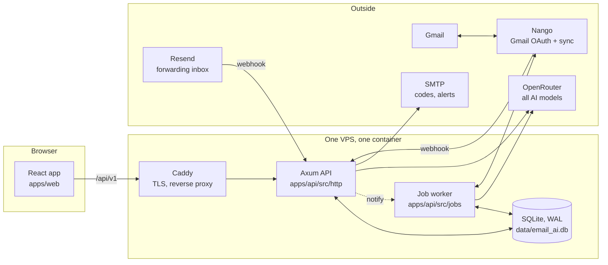
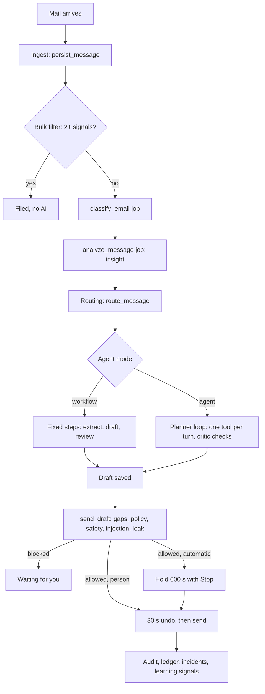
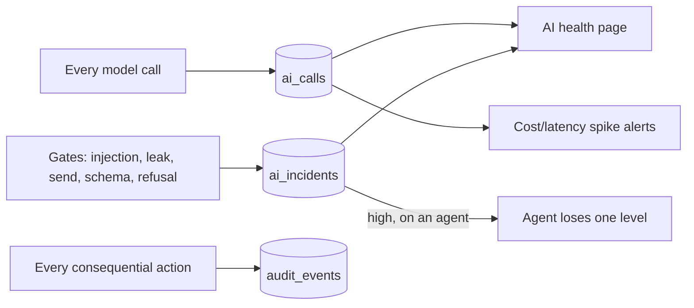

# 02. Architecture: the system map

**Goals.** Draw the system from memory. Trace one email from Gmail to a sent reply, naming the file for each step.
Explain multi-tenancy, packs and the main tables.

**Prerequisites.** Modules 00 and 01. **Reading time.** 2 hours.

## 1. The big picture



Three facts to hold in your head:

1. **One process.** `email-ai-api serve` runs the API and the worker together (`apps/api/src/main.rs:24`). They
   share one SQLite file. There is no Redis, no queue service, no vector DB.
2. **The API does no heavy work.** Webhooks verify, write a row and a job, and return 2xx
   (`apps/api/src/http/webhooks.rs:22`). All provider and AI calls run in the worker.
3. **The web app is static files served by the API** (`WEB_DIST_DIR`, `Dockerfile:14`). One image to deploy.

## 2. The three layers

| Layer | Where | What lives there |
|---|---|---|
| HTTP | `apps/api/src/http/*_api.rs`, `http/mod.rs` | One file per area. Extractors check auth; handlers check membership; every query filters `workspace_id`. |
| Domain | `apps/api/src/{agents,agent_registry,ai,learning,staffing,team,designer,evals,...}` | Pure functions and DB functions. Most take `&SqlitePool` or `&mut SqliteConnection`, not an HTTP request. |
| Jobs | `apps/api/src/jobs/` | The worker loop, the job table, one handler per job kind. The pipeline is a chain of jobs. |

The domain layer is where the rules live. HTTP and jobs are thin callers. When you look for "why did X happen",
start in the domain module, not the handler.

## 3. The job queue

The queue is a table, `jobs`, with `status`, `run_at`, `attempts`, `locked_by`, `locked_until`, `dedupe_key`
and `priority`.

- **Claim** is one atomic statement: `UPDATE jobs SET status='running', locked_by=?, locked_until=now+120s ...
  WHERE id = (SELECT ... LIMIT 1) RETURNING *` (`apps/api/src/jobs/mod.rs:186`). Two workers can never take the
  same job.
- **Lease**: 120 s (`LEASE_MS`, `jobs/mod.rs:22`). If a worker dies, the lease expires and the job is claimable
  again. `complete` and `fail` check `locked_by` and `attempts` so a stale worker cannot overwrite a newer claim
  (`jobs/mod.rs:211`).
- **Retry**: exponential backoff with jitter, 2 s, 4 s, 8 s... capped at 5 minutes (`backoff_ms`, `jobs/mod.rs:226`).
  After `max_attempts` (5, or 12 for provider fetches) the job is `dead` and shows on the Jobs page for an admin to
  retry (`sweep_exhausted`, `jobs/mod.rs:253`; `on_dead`, `jobs/handlers.rs:168`).
- **Dedupe**: `enqueue` is `INSERT ... ON CONFLICT(dedupe_key) DO UPDATE ... WHERE status='dead'`
  (`jobs/mod.rs:118`). Enqueue the same key twice and you get one job; a dead one is revived.
- **At-least-once**: every handler must be idempotent (`jobs/mod.rs:1`). Idempotency keys are listed in
  `README.md` ("Key design choices").
- **Wake-up**: the API calls `state.jobs_notify.notify_one()` after writing a job; the worker sleeps on that
  `Notify` or a 1 s poll (`jobs/worker.rs:46`).
- **Maintenance** every 30 s (`jobs/worker.rs:108`): sweep expired leases, enqueue mailbox polling, alert
  evaluation, agent ticks, metrics rollup, match digest, staffing scan, hourly purge, nightly backup, text clean.

Compare to Node: this is BullMQ without Redis. The trade: simpler ops, one writer at a time.

## 4. One email, step by step



Follow it in code, in order:

| Step | What happens | Where |
|---|---|---|
| 1. Arrive | Gmail: Nango webhook `sync` enqueues `sync_nango_source`; the worker pulls records from Nango `GET /records` (bounded backfill, then cursor). Forwarding: Resend webhook, Svix signature checked on the raw body, `inbound_events` row and `fetch_forwarded_email` job in one transaction. | `apps/api/src/sources/nango.rs:1`, `apps/api/src/http/webhooks.rs:22`, `apps/api/src/sources/resend.rs` |
| 2. Ingest | `persist_message` stores once per `(source_id, source_message_id)`, puts it in a thread, stores attachment metadata, writes an audit row, enqueues `classify_email`. Mail the team sent is `outbound` and skipped by AI. Suppressed mail (privacy wall, policy) is marked and skipped by every read path. | `apps/api/src/ingest.rs:30`, `apps/api/src/staffing/policy.rs` |
| 3. Bulk filter | Header evidence (`List-Unsubscribe`, `Precedence`, `Auto-Submitted`, Gmail category, no-reply sender) is stored at ingest. Two or more signals from an unknown sender, and not billing or legal, files the mail with no model call. | `apps/api/src/bulk.rs:15` |
| 4. Classify and understand | One label call plus one analysis call (today). Understanding v2 does both in one structured call and runs in shadow (`UNDERSTAND_V2=shadow`). The label goes to `classifications`, the insight to `message_insights`. `needs_review` is a backend policy, never the model's choice. A single-flight guard stops duplicate analyses. | `apps/api/src/jobs/handlers.rs:125`, `apps/api/src/ai/understand.rs:160`, `apps/api/src/ai/policy.rs:11`, `apps/api/tests/single_flight.rs` |
| 5. Route | A pure function, no AI: manual > thread > rule > label > personal > generic > lead. Written to `message_routes`. An agent at level 0 gets a shadow case; a level 1+ agent does the real work. | `apps/api/src/agent_registry/routing.rs:176`, `:340` |
| 6. Case | `start_inbox_case` creates a `cases` row and enqueues `agent_step` turn 1. Each turn is one durable job, so a case survives restarts and can sleep for days. | `apps/api/src/agents/triggers.rs:217`, `apps/api/src/agents/case.rs:193` |
| 7. Workflow or planner | Workflow mode: `workflow::decide` returns the next fixed tool call from the spec's steps. Agent mode: the planner model picks one tool; `critic::hard_rules` then a cheap critic model check it. | `apps/api/src/agents/workflow.rs:101`, `apps/api/src/agents/runner.rs:146`, `apps/api/src/agents/critic.rs:65` |
| 8. Draft | The drafter builds from a verified context pack (thread, profile, preferences, sourced facts). Unsupported claims become `[NEEDS: ...]`. | `apps/api/src/learning/context_pack.rs:32`, `:103` |
| 9. Guard | `send_draft` refuses gaps first, checks source capabilities, reconciles any earlier attempt, runs `send_safety::check` (deterministic checks, leak check, judge questions). An automatic send gets one repair; if still blocked it is handed off to a person and logged as an incident. | `apps/api/src/replies.rs:509`, `apps/api/src/send_safety.rs:236`, `:501`, `:572` |
| 10. Hold and undo | The send is scheduled at `now + max(undo, hold)`. A person's send: 30 s undo. An agent's: 600 s hold (`AGENT_AUTO_SEND_DELAY_SECS`) with Stop. A `send_draft` job fires at that time. | `apps/api/src/replies.rs:558`, `apps/api/src/agents/autonomy.rs:340` |
| 11. Send | Through the owner's Gmail via Nango, in the thread, with an attempt id (`attempt_message_id`) reconciled if the process dies mid-send. | `apps/api/src/replies.rs:247`, `:287`, `:400` |
| 12. Record | Audit row in the same transaction; ledger row per model call; incident on any near-miss; learning signal on edit, approve, decline. | `apps/api/src/audit.rs`, `apps/api/src/ai_ledger.rs:187`, `apps/api/src/incidents.rs:150`, `apps/api/src/learning/signals.rs:159` |

## 5. Multi-tenancy

A **workspace** is the tenant. Users join workspaces with a role (`admin`, `operator`, `member`;
`apps/api/src/auth.rs:236`, `require_role`). Three rules:

1. Every route under `/workspaces/{ws}/...` checks the caller's membership in `{ws}` first.
2. Every query that takes an id also filters on `workspace_id`. Example: `SELECT agent_id FROM drafts WHERE id = ?1
   AND workspace_id = ?2` (`apps/api/src/replies.rs:485`).
3. `apps/api/tests/tenant_isolation.rs` reads every route out of `src/http/*.rs` with a regex and calls each as a
   member of another workspace with the first workspace's ids. It expects 403 or 404 and never data. Add a route
   without a way to fill its ids and the test fails.

Inside a workspace there is a second wall: **personal** agents and personal mail belong to one member.
`store::visible_to` and `hide_foreign_personal` (`apps/api/src/agent_registry/store.rs:114`, `:120`) filter them.

## 6. Packs

A pack is a switch stored per workspace (`apps/api/src/packs.rs`). Turning it on:
- adds its labels (`label_packs`, migration `0042`),
- seeds its agent templates (`apps/api/src/agent_registry/seed.rs`, from `templates::for_packs`),
- for HR, shows the HRMS pages (`apps/web/src/app/nav.ts:7`, `hasStaffing`).

Turning it off pauses its agents with `paused_reason = 'pack_off'` (`seed.rs:158`); the hub still shows them
locked with "Its pack is turned off" (`apps/web/src/features/agents-hub/AgentCard.tsx:36`). Turning it back on
restores them (`seed.rs:128`). General cannot be turned off.

## 7. Data model: the tables that matter

Forty-four migrations in `apps/api/migrations/`. The core ones, grouped:

| Group | Tables | Notes |
|---|---|---|
| Tenancy and auth | `workspaces`, `users`, `memberships`, `sessions`, `invites` | `0001_core.sql`, `0005_password_auth.sql` |
| Mail | `email_sources`, `email_messages`, `email_threads`, `attachments`, `inbound_events` | `direction` inbound/outbound; `suppressed`; `bulk_signals` (`0041`) |
| Understanding | `classifications`, `message_insights`, `understanding_shadow`, `labels` | `source` = jev, llm, fallback, manual; insight holds summary, asks, deadlines |
| Jobs | `jobs` | lease, attempts, dedupe_key, priority (`0018`) |
| Replies | `drafts`, `reviews`, `workflow_runs` | `send_at`, `send_attempt_id`, `origin_key` (`0023_send_safety.sql`) |
| Agents | `agents`, `agent_versions`, `cases`, `case_steps`, `agent_approvals`, `message_routes`, `agent_autonomy_changes` | `0022_agents.sql`, `0034_agent_registry.sql`, `0037_metrics_evals.sql` |
| Learning | `memories`, `memories_fts`, `user_preferences`, `learning_signals`, `agent_profiles` | `0004`, `0026`, `0036` |
| Knowledge | `knowledge_chunks`, `knowledge_fts`, `knowledge_vec` (vec0, 1024 dims, cosine) | `0010`, `0015` |
| Ops | `ai_calls`, `ai_incidents`, `audit_events`, `alerts`, `agent_metrics_daily`, `eval_runs` | `0021`, `0040`, `0046`, `0037` |
| HRMS | `people`, `submissions`, `requirements`, `candidates`, `matches`, `portal_rows`, `escalations` | `0009`, `0017`, `0035` |

Rule from `docs/architecture.md` section 13: applied migrations are never edited. New ones take the next free
number. Numbers can skip (there is no `0025`); SQLx only cares that each applied file is unchanged.

## 8. The web app

React 19, Vite, TanStack Query, Tailwind, react-router (`apps/web/package.json`). One folder per page area in
`apps/web/src/features/`; routes in `apps/web/src/app/routes.tsx`; nav in `app/nav.ts`. The API client is one
function, `api<T>(path, opts)` (`apps/web/src/api/client.ts:60`), that adds the `X-Auth-Token` header and turns the
error body into `ApiError`. In dev, Vite proxies `/api`, `/health` and `/webhooks` to `:8080`
(`apps/web/vite.config.ts`). In production the API serves `dist/` itself.

## 9. Observability in one picture



- Ledger: `ai_ledger::record_full` (`apps/api/src/ai_ledger.rs:187`) per call: task, model, tokens, cost, latency,
  `ok`, `schema_ok`, error class, case and message ids. `within_budget` (`:314`) gates automatic work.
- Incidents: eight kinds (`apps/api/src/incidents.rs:19`), severity per incident, deduped, best-effort.
- Audit: `audit::record` in the same transaction as the action, ids only, never mail text.
- Health: `GET /workspaces/{ws}/ai-health` (`apps/api/src/http/ai_health_api.rs:23`), spike floor $0.50 and 2x the
  7-day average (`apps/api/src/ai_health.rs:21`).

## In this repo

- `docs/architecture.md`: the long form of this module, with the security table (section 11).
- `README.md` "Key design choices": the webhook rule, the first-statement-is-a-write rule, idempotency keys.
- `apps/api/src/jobs/mod.rs`: read the whole file once; it is 300 lines and explains the queue completely.
- `apps/api/src/agent_registry/routing.rs`: read `route` and its tests.

## Exercises

1. **Trace a test email.** Run `make api` and `make web`, sign in (dev auth), create a workspace, send a test email
   from Integrations. Then open the database read-only and watch it move:
   ```bash
   python3 -I -c "import sqlite3; c=sqlite3.connect('file:apps/api/data/email_ai.db?mode=ro', uri=True); \
   [print(r) for r in c.execute('SELECT kind, status, attempts, dedupe_key FROM jobs ORDER BY created_at DESC LIMIT 15')]"
   ```
   Repeat for `audit_events` and `message_routes`. Write down the order of job kinds you saw.
2. **Break dedupe on purpose.** Read `enqueue_at` (`apps/api/src/jobs/mod.rs:118`). Predict what happens if you
   enqueue `classify_email` twice with the same key while the first is `pending`. Then check `tests/pipeline.rs` for
   the test that proves it.
3. **Draw the tenancy wall.** Pick one handler in `apps/api/src/http/messages.rs`. Mark the membership check and
   every `workspace_id` filter. Then read the top of `apps/api/tests/tenant_isolation.rs` and explain how your
   handler is covered without anyone writing a test for it.
4. **Add a job kind (on paper).** You want a weekly "digest of unanswered mail". List the four edits you would make
   (`jobs/mod.rs` kind, `jobs/handlers.rs` dispatch, a module with the handler, a `maintenance` scheduler call) and
   which dedupe key you would use so it runs once per week per workspace.

## Check yourself

1. Why does the webhook handler not call Nango or the model?
2. What stops two workers from running the same job?
3. In which order does routing pick an agent, and which step uses AI?

<details>
<summary>Show answers</summary>

1. Webhooks must answer fast and never lose an event. The handler verifies the signature, writes the event and a job in one transaction and returns 2xx (`apps/api/src/http/webhooks.rs:22`). Slow or failing provider and AI calls run in the worker with retries and a dead-letter list. It also keeps network calls out of SQLite transactions.
2. The claim is a single `UPDATE ... WHERE id = (SELECT ... LIMIT 1) RETURNING` (`apps/api/src/jobs/mod.rs:186`). SQLite runs it atomically, so only one worker gets the row. The lease (`locked_until`) plus the `(locked_by, attempts)` check in `complete` and `fail` fence out a worker whose lease expired.
3. Manual choice, then an open case or earlier route in the thread, then rule triggers (domains, addresses, keywords, attachment types, priority), then label triggers, then the owner's personal agent, then a generic "needs reply" trigger, then the lead (Meera) as fallback (`apps/api/src/agent_registry/routing.rs:176`). None of these steps calls a model; routing is a pure function over stored facts.
</details>

**Next:** [03. Tools and commands](03-tools-and-commands.md).
