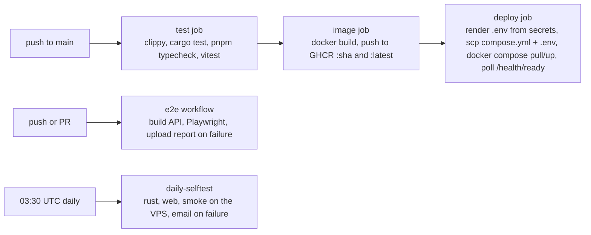

# 03. Tools and commands

**Goals.** Build, test, lint, run and deploy Post Room. Read logs. Debug a failed deploy or a failed e2e run. Know
what every tool in the chain does and why it is there.

**Prerequisites.** Modules 01 and 02. **Reading time.** 1.5 hours; most of it is running commands.

Every block below is copy-paste ready from the repo root unless it says otherwise.

## 1. The map of tools

| Tool | Job | Where it is configured |
|---|---|---|
| `cargo` | Build, test, lint the Rust API | `apps/api/Cargo.toml` |
| `clippy` | Rust linter, warnings are errors in CI | `.github/workflows/deploy.yml:37` |
| `sqlx` (library) | SQL and migrations, run at app start | `apps/api/src/db.rs:72`, `apps/api/migrations/` |
| `pnpm` | Node package manager for the web app | `apps/web/package.json`, pnpm 12.5.1 |
| `vite` | Dev server and production build of the web app | `apps/web/vite.config.ts` |
| `vitest` | Web unit tests (jsdom) | `apps/web/vite.config.ts` `test` block |
| `playwright` | Browser e2e against the real API | `apps/web/playwright.config.ts`, `apps/web/e2e/` |
| `make` | Short names for the common commands | `Makefile` |
| `docker` / `compose` | One image, one container on the VPS | `Dockerfile`, `compose.yml` |
| Caddy | TLS and reverse proxy on the VPS, outside this repo | `docs/architecture.md` section 13 |
| GitHub Actions | Tests, image build, SSH deploy, daily self-test, e2e | `.github/workflows/*.yml` |
| `gh` | GitHub CLI for runs, logs, PRs | your machine |
| `git worktree` | Several branches checked out side by side | `.claude/worktrees/` |
| `python3` + `sqlite3` module | Read the production database without installing anything | the VPS |

## 2. Local development

```bash
cp .env.example .env            # once; set AUTH_MODE=dev and ALLOW_DEV_AUTH=1 for a quick demo login
make api                        # cargo run -- serve: API + worker on :8080, migrations on start
make web                        # in a second terminal: Vite on :5173, proxies /api to :8080
```

`make api` is `cargo run --manifest-path apps/api/Cargo.toml -- serve` (`Makefile:5`). The first build takes
minutes; later builds are incremental. `make migrate` runs only migrations.

Other process modes (`apps/api/src/main.rs:6`): `email-ai-api api` and `email-ai-api worker` run the two halves
as separate processes on the same host, sharing the SQLite file.

Without an `OPENROUTER_API_KEY` the app still works: rules classifier, template drafts, no planner. That is enough
for most exercises in this curriculum.

## 3. cargo: build, test, lint

```bash
cd apps/api
cargo build                                   # debug build of the lib and both binaries
cargo build --release --locked                # what the Dockerfile runs
cargo test                                    # unit + integration tests (~55 test binaries)
cargo test --test golden_offline -- --nocapture   # one integration test file, with println output
cargo test routing                            # tests whose name contains "routing"
cargo test --test tenant_isolation
cargo clippy --all-targets -- -D warnings     # lint; any warning fails
cargo fmt --check                             # formatting (not enforced in CI today)
```

**Why two env vars in CI.** `.github/workflows/deploy.yml:20` and `e2e.yml:18` set:

```yaml
CARGO_PROFILE_DEV_DEBUG: "0"
CARGO_INCREMENTAL: "0"
```

Each integration test file in `apps/api/tests/` becomes its own binary. With full debug info, about 55 such
binaries exhaust the GitHub runner's disk at link time. `CARGO_PROFILE_DEV_DEBUG=0` drops debug info from test
builds; `CARGO_INCREMENTAL=0` skips the incremental cache that is useless on a fresh runner and also takes disk.
Use the same two lines locally if your disk is tight:

```bash
CARGO_PROFILE_DEV_DEBUG=0 CARGO_INCREMENTAL=0 cargo test --manifest-path apps/api/Cargo.toml
```

**Live evals cost money** and are `#[ignore]`d. Run them on purpose only:

```bash
cd apps/api
OPENROUTER_API_KEY=... cargo test --test golden_live -- --ignored --nocapture
GOLDEN_FILTER=inj_ OPENROUTER_API_KEY=... cargo test --test golden_live -- --ignored --nocapture
```

## 4. pnpm, vite, vitest, playwright

```bash
cd apps/web
pnpm install --frozen-lockfile     # exactly the lockfile; fails if package.json drifted
pnpm dev                           # Vite on :5173
pnpm typecheck                     # tsc -b --noEmit
pnpm test --run                    # vitest once (without --run it watches)
pnpm build                         # tsc -b && vite build -> dist/
pnpm e2e                           # vite build && playwright test (builds the API too)
pnpm e2e:prod                      # only smoke.prod.spec.ts against the live URL (E2E_PROD=1)
```

Vitest config lives inside `vite.config.ts` (`test` block: jsdom, `src/test/setup.ts`, excludes `e2e/`). Unit
tests sit next to components (`apps/web/src/features/inbox/MessageList.test.tsx`).

Playwright (`apps/web/playwright.config.ts`): Chromium only, one worker, `webServer` starts two things before the
tests: a Nango stand-in (`e2e/support/mock-nango.mjs`) and the real API (`e2e/support/start-api.mjs`) with a fresh
SQLite file, `AI_MOCK=1`, `MAIL_CAPTURE_FILE` for sent mail, and the built web app served from the same origin. No
network calls to AI providers. `e2e/global-setup.ts` signs up admin, operator and outsider accounts and saves
their sessions. On failure, traces, screenshots and videos land in `apps/web/e2e/.results` and the HTML report in
`apps/web/e2e/.report`.

```bash
cd apps/web
pnpm exec playwright install --with-deps chromium     # once
pnpm exec playwright test e2e/reply-send-undo.spec.ts # one spec
pnpm exec playwright show-report e2e/.report          # open the last HTML report
pnpm exec playwright show-trace e2e/.results/<folder>/trace.zip
```

`AI_MOCK` and `MAIL_CAPTURE_FILE` are refused when `PUBLIC_WEB_URL` is https or `APP_ENV` is production
(`apps/api/src/config.rs:344`). You cannot accidentally run production on fakes.

## 5. SQLite: looking inside the database

Locally the file is `apps/api/data/email_ai.db` (`DATABASE_URL` in `.env`). On the VPS it is
`/docker/email-agents/data/email_ai.db`, owned by uid 10001 (the `app` user in the image).

The VPS may not have the `sqlite3` CLI. Python's standard library does, so use it **read-only** with a URI:

```bash
# on the VPS
cd /docker/email-agents
python3 -I - <<'PY'
import sqlite3
c = sqlite3.connect("file:data/email_ai.db?mode=ro", uri=True)
for row in c.execute("SELECT kind, status, COUNT(*) FROM jobs GROUP BY 1,2 ORDER BY 1,2"):
    print(row)
for row in c.execute("SELECT task, COUNT(*), ROUND(SUM(cost_usd),4) FROM ai_calls WHERE created_at > (strftime('%s','now')-86400)*1000 GROUP BY 1"):
    print(row)
PY
```

`mode=ro` means you cannot write by mistake. `-I` runs Python in isolated mode so no stray `.py` file in the
directory can be imported. Never open the live file read-write while the app runs; use a backup copy instead
(section 9).

Useful queries while learning:

```sql
SELECT id, kind, status, attempts, last_error FROM jobs WHERE status = 'dead';
SELECT action, entity_type, created_at FROM audit_events ORDER BY created_at DESC LIMIT 20;
SELECT kind, severity, resolved_at IS NULL AS open FROM ai_incidents ORDER BY created_at DESC LIMIT 20;
SELECT name, kind, status, autonomy_level, autonomy_cap FROM agents WHERE workspace_id = ?;
PRAGMA journal_mode;          -- wal
PRAGMA wal_checkpoint(PASSIVE);
```

## 6. git worktrees

This repo uses worktrees for parallel branches (`git worktree list` shows `.claude/worktrees/wp-*`). One clone,
many checkouts, each with its own `target/` and `node_modules/`.

```bash
git worktree add .claude/worktrees/wp-feature -b wp-feature main   # new branch in a new folder
git worktree list
git -C .claude/worktrees/wp-feature status
git worktree remove .claude/worktrees/wp-feature                   # after merge
git worktree prune
```

Rule used in this project: never `git checkout` or `git switch` inside the main checkout while worktrees exist;
work in the worktree folder. Commit on the branch, then merge into `main` from the main checkout.

## 7. gh: the GitHub CLI

```bash
gh run list --workflow deploy --limit 5
gh run view <run-id> --log-failed            # only the failing steps' logs
gh run watch                                 # follow the latest run
gh run download <run-id> -n playwright-report  # e2e artifacts
gh workflow run daily-selftest -f simulate_failure=true   # prove the failure email arrives
gh secret list
gh pr create --fill
```

## 8. The CI/CD pipeline



**`deploy.yml`** (`.github/workflows/deploy.yml`):

1. `test`: Rust clippy and tests, web typecheck and tests. Caches: `Swatinem/rust-cache`, pnpm store.
2. `image`: `docker/build-push-action` with `cache-from/to: type=gha`. Tags `ghcr.io/anukulrajan7/email-agents:<sha>`
   and `:latest`. Only this job has `packages: write`.
3. `deploy`: writes `deploy.env` from GitHub secrets and vars (model ids, keys, SMTP, budgets), `scp` it and
   `compose.yml` to `/docker/email-agents` on the VPS, logs in to GHCR with the job's token, `docker compose pull
   && docker compose up -d --no-build --remove-orphans`, then polls `http://127.0.0.1:18090/health/ready` over SSH
   for up to 60 s. If it never turns ready it prints `docker compose logs --tail 80` and fails.

`concurrency: deploy-production, cancel-in-progress: false`: two pushes queue; a deploy is never cut in half.

**`e2e.yml`**: runs on every push and PR, builds the API binary once (`cargo build --bin email-ai-api`), then
`pnpm e2e`. Artifacts on failure.

**`daily-selftest.yml`** (`docs/selftest.md`): `rust`, `web`, and `smoke` (over SSH: container running, readiness
on the VPS, readiness on the public URL, then `docker compose exec -T app selftest`, a tool-calling probe of every
configured model). Any failure emails the owner with the failing step and the last 80 log lines
(`.github/scripts/selftest-report.sh`). Mondays all-green send a short summary.

## 9. Docker, Compose, Caddy, the VPS

**`Dockerfile`**: three stages. `node:24-bookworm-slim` builds the web app; `rust:1-bookworm` runs
`cargo build --release --locked`; `debian:bookworm-slim` holds only `ca-certificates`, the two binaries
(`email-ai-api`, `selftest`), the `dist/` folder, and a non-root `app` user (uid 10001). `CMD ["email-ai-api",
"serve"]`.

**`compose.yml`**: one service, `app`, `network_mode: host`, bound to `127.0.0.1:18090` by `API_BIND_ADDR`, env
from `.env`, volume `./data:/app/data`, `restart: unless-stopped`. In CI `IMAGE` and `IMAGE_TAG` come from `.env`;
locally `build: .` is used.

**Caddy** runs on the host (not in this repo) and owns ports 80 and 443. It terminates TLS for
`mail.anukulraj.tech` and proxies to `127.0.0.1:18090`. Because the API trusts `X-Forwarded-For` only from
loopback (`apps/api/src/main.rs:32`), rate limits see the real client IP.

VPS layout:

```
/docker/email-agents/
  compose.yml          # copied by the deploy job
  .env                 # rendered from secrets; owner-only
  data/
    email_ai.db        # SQLite, WAL mode (+ -wal and -shm files while running)
    backups/
      email_ai-20261015.db   # nightly VACUUM INTO, newest 7 kept
```

Day-to-day on the VPS:

```bash
ssh root@<vps>
cd /docker/email-agents
docker compose ps
docker compose logs --tail 200 -f app
docker compose logs --since 30m app | grep -i "error\|dead-lettered"
docker compose exec -T app selftest           # model probe
docker compose pull && docker compose up -d   # redeploy the current tag
docker compose restart app
ls -la data/backups
```

**Backups** (`apps/api/src/backup.rs`): a nightly job runs `VACUUM INTO data/backups/email_ai-YYYYMMDD.db`, a
consistent copy while the app keeps running, owner-only permissions, newest seven kept. Restore = stop the app,
copy a backup over `data/email_ai.db`, remove stale `-wal`/`-shm` files, start the app. A restore drill in CI is on
the after-v1 list.

## 10. Reading logs

The API logs with `tracing` in text form; `RUST_LOG` controls the level (`RUST_LOG=info,tower_http=info` in
production, `.github/workflows/deploy.yml:116`). Every HTTP request has a `request_id` span
(`apps/api/src/error.rs:21`), echoed in the `x-request-id` header and in every error body. Every job has a span
with `job_id`, `kind` and `attempt` (`apps/api/src/jobs/worker.rs:64`).

Lines you will meet:

| Log line | Meaning | Where |
|---|---|---|
| `job succeeded kind=classify_email ms=...` | A job finished | `worker.rs:78` |
| `job failed, will retry` | Transient error, backoff scheduled | `worker.rs:88` |
| `job dead-lettered` | Out of attempts or permanent error; see Jobs page | `worker.rs:85` |
| `lease expired with no attempts left` | Worker died mid-job and no retries remain | `worker.rs:109` |
| `internal error error=...` | A 500; the error body carries the `request_id` | `error.rs:106` |
| `designer model failed; trying the fallback` | First model failed, second model asked | `designer/mod.rs:106` |
| `daily AI budget reached; case resumes tomorrow` | Budget guard parked a case | `agents/runner.rs:173` |
| `budget check failed; allowing` | Ledger lookup failed; product keeps working | `ai_ledger.rs:318` |

When a user reports an error, ask for the `request_id` shown in the error toast, then:

```bash
docker compose logs --since 24h app | grep <request_id>
```

## 11. Debugging a failed deploy

1. `gh run view <id> --log-failed`. Which job failed: `test`, `image` or `deploy`?
2. `test` failed: reproduce locally with the same two env vars from section 3. Clippy warnings are the common case.
3. `image` failed: usually a `Cargo.lock` out of date (`--locked`) or a web build type error. Run
   `docker build .` locally.
4. `deploy` failed at "Health check": the container started but `/health/ready` never answered. The job already
   printed the last 80 log lines. Typical causes: a migration failed (SQLx checksum mismatch because an applied
   migration was edited; fix by adding a new migration, never by editing), a missing env var that `Config::from_env`
   requires, or the port already taken. On the VPS: `docker compose logs --tail 200 app`.
5. Roll back: `IMAGE_TAG=<previous sha>` in `/docker/email-agents/.env`, then `docker compose pull && docker compose
   up -d`. Previous tags are listed under Packages on GitHub.

## 12. Debugging a failed e2e run

1. `gh run download <id> -n playwright-report`, then `pnpm exec playwright show-report <folder>`.
2. Open the failing test's trace (`show-trace`). You see every click, network call and the DOM at each step.
3. Reproduce locally: `cd apps/web && pnpm e2e -- <spec file>`; add `--headed` to watch it; `--debug` to step.
4. Flaky-looking failures are usually timing: the API's worker processes jobs asynchronously. Specs wait on UI
   state, not on sleeps; check `apps/web/e2e/support/api.ts` for the helpers that poll.
5. The API log for the run is in the Playwright output (`stdout: 'pipe'` for the webServer).

## Why tests are fast now

- Per-file binaries became one binary: Rust links every file in `tests/` separately, so 61 files meant 61 links. Now `tests/api.rs` pulls every file in as a module (files did not move), so there is one link.
- Migrations per test became a template copy: every test used to run all the migrations on a fresh SQLite file. Now that happens once per run, and each test copies the finished file (`db::seed_from_template`, used when `Config::for_tests` is set).
- Repeated safety runs became one shared run: `run_for_spec` ran 49 scenarios one after another, and several tests asked for the same spec. Now scenarios run 8 at a time and `common::safety_suite` caches the result per spec. (There are no real-time waits in the tests: the 10-minute send hold is checked against the clock value, not slept.)

Adding a test file: add two lines to `tests/api.rs` (`#[path = "x.rs"]` and `mod x;`). A guard test fails if you forget.

Measured on a 10-core M4 Mac, deps already cached, `CARGO_PROFILE_DEV_DEBUG=0`, `cargo test --no-fail-fast`:

| | before | after |
|---|---|---|
| Whole run (build + link + tests) | 676 s | 99 s |
| Test execution only | about 450 s | 45 s |
| `experts` + `workflow_gate` tests | about 208 s | 20 s |
| Rebuild after touching one test file | not measured | 10 s |

Test count is the same (875 passed, 3 ignored) plus one new guard test.

## In this repo

- `Makefile`: the five commands you use every day.
- `.github/workflows/deploy.yml`, `e2e.yml`, `daily-selftest.yml`: read them top to bottom once.
- `docs/selftest.md`: the self-test, the model probe, the emails.
- `apps/web/e2e/support/start-api.mjs`: how a real API is started for browser tests.

## Exercises

1. **Run everything.** From a clean clone: `make test`, `make check`, `cd apps/web && pnpm e2e`. Time each. Note
   which one you would run before every commit and which only in CI.
2. **Read a deploy.** `gh run list --workflow deploy --limit 1`, then `gh run view <id>`. Find the image tag that
   was deployed, and confirm on the VPS that `docker compose ps` shows the same tag.
3. **Break the build on purpose.** Add an unused variable to any handler and run `cargo clippy --all-targets --
   -D warnings`. Read the message. Fix it. Now add `let x = 1;` inside a test and see that clippy also checks tests
   (`--all-targets`).
4. **Restore drill at home.** Copy `apps/api/data/email_ai.db` to a temp folder, run `python3 -I -c` with
   `VACUUM INTO 'copy.db'` on it, stop the API, swap the files, start the API. Write down the steps; they are the
   missing CI job from the after-v1 list.

## Check yourself

1. Why does CI set `CARGO_PROFILE_DEV_DEBUG=0`?
2. What does the deploy job do if `/health/ready` never answers?
3. How do you look inside the production database safely?

<details>
<summary>Show answers</summary>

1. Each file in `apps/api/tests/` compiles to its own test binary. About 55 of them with full debug info fill the runner's disk during linking. Turning debug info off for the dev profile keeps the builds small. `CARGO_INCREMENTAL=0` saves more disk by skipping the incremental cache, which does not help on a fresh runner (`.github/workflows/deploy.yml:20`).
2. It polls over SSH thirty times with two-second sleeps. If none succeeds it prints the container's last 80 log lines and exits 1, so the run is red and you have the failure reason in the job output (`.github/workflows/deploy.yml:159`). The old container is already replaced, so you roll back by setting the previous `IMAGE_TAG` in `.env` and running `docker compose pull && docker compose up -d`.
3. Read-only, with Python's built-in `sqlite3` module and a URI: `sqlite3.connect("file:data/email_ai.db?mode=ro", uri=True)`, run with `python3 -I`. Never open the live file read-write while the app runs; for experiments copy a nightly backup from `data/backups/`.
</details>

**Next:** [04. AI and email basics](04-ai-email-basics.md).
