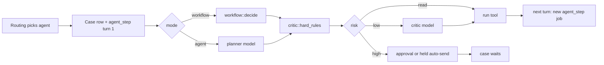
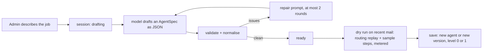

# 05. Agentic architecture

**Goals.** Explain what an agent is here and how it differs from a workflow. Read an `AgentSpec` and know what each
field permits. Trace routing, autonomy, approvals, planner and critic in code. Create, update, version and roll
back an agent through the API and the designer. Build a timesheet agent end to end. Organise a team of agents
without overlap.

**Prerequisites.** Modules 02 and 04. **Reading time.** 3 hours. The worked example in section 9 takes an hour on
its own; do it with the app running.

## 1. Agent versus workflow

`docs/agent-building-guide.md` section 1: *single call first, then a workflow, then an agent.*

| | Workflow (`mode: "workflow"`) | Agent (`mode: "agent"`) |
|---|---|---|
| Steps | Fixed list in the spec (`steps`) | A planner model picks one tool per turn |
| Cost | One draft call, maybe one extract | 4 to 5 planner turns plus a critic per action |
| When | You can write the steps in advance: acknowledge, review, remind | You cannot: multi-day requirement cases, follow-ups, escalations |
| Code | `agents/workflow.rs:101`, `decide` returns the next tool from `steps_for(spec)` | `agents/runner.rs:146`, `run_step` asks the planner |

Both run on the **same runtime**: a case, durable steps, the same tools, the same critic rules, the same send
guards. A workflow case can hand over to the planner when a step needs judgement (`decide` returns `None`,
`workflow.rs:138`, for example a reply arrived during a `remind_if_no_reply` wait).

Analogy: a workflow is a checklist taped to the desk. An agent is a colleague with a goal and a phone list. You give
the checklist to the intern; you give the goal to someone who has proven they ask before promising money.

## 2. The agent spec

An agent *is* its spec: plain data, validated in code before anything runs (`apps/api/src/agent_registry/spec.rs:299`).

```json
{
  "name": "Rohan", "key": "timesheets_desk", "category": "hrms",
  "description": "Acknowledges timesheets and chases missing or unclear hours.",
  "goal": "Acknowledge each timesheet and flag anything missing",
  "mode": "workflow",
  "triggers": [{ "type": "email_received", "match": { "labels": ["timesheet"] } }],
  "steps": [{ "type": "draft_reply", "quality": "balanced" }, { "type": "create_review", "title": "Check: Timesheet" }],
  "tools": ["read_email", "read_thread", "recall_memory", "search_mail", "draft_email", "create_task", "update_case", "send_email"],
  "scopes": ["read_mail", "draft", "send", "label"],
  "permissions": { "draft": true, "send": "earned", "max_autonomy": 2, "daily_send_cap": 20 },
  "memory": { "scope": "own+shared", "learn_from": ["edits", "approvals", "labels", "routes"] },
  "drafting": { "rules": [], "never_do": [], "quality_tier": "balanced" },
  "budget": { "max_steps": 15, "usd_per_case": 0.10 }
}
```

This is the shape `templates::timesheets` builds (`apps/api/src/agent_registry/templates.rs:327` through `hr_desk`
at `:300`). Field by field:

| Field | Type | What it controls | Where enforced |
|---|---|---|---|
| `triggers` | `Trigger` enum (`spec.rs:147`): `email_received {match}`, `schedule {every_hours}`, `manual` | When the agent is considered for a message. `match` has labels, from_domains, from_addresses, subject_keywords, needs_reply, priority, attachment_types | `routing::match_trigger`, `routing.rs:95` |
| `steps` | `Step` enum (`spec.rs:183`): extract, draft_reply, create_review, remind_if_no_reply, save_to_gmail_drafts, label, start_case, notify | The fixed path in workflow mode. Each step needs its tools in `tools` (`Step::required_tools`, `spec.rs:199`) | `workflow::steps_for`, `workflow.rs:43` |
| `tools` | names from the registry (`agents/tools.rs:199`) | The planner is offered only these | `CaseAgent::allowed_tools`, `agent_registry/runtime.rs:43` |
| `scopes` | `read_mail`, `draft`, `send`, `label`, `schedule` (`spec.rs:26`) | Every tool must be covered by a scope (`scope_of_tool`, `spec.rs:52`). A read-only agent cannot draft whatever its prompt says | `validate_basic` |
| `permissions.send` | `never`, `ask`, `earned` (`spec.rs:82`) | `earned` = may go out alone once level 2 is reached | `autonomy::standing_block`, `autonomy.rs:213` |
| `permissions.max_autonomy` | 0 to 3 | The spec's own ceiling on level | `effective_level`, `autonomy.rs:45` |
| `permissions.daily_send_cap` | number, default 20 | Automatic sends per day per owner | `autonomy::sent_today`, `:196` |
| `drafting.never_do` | sentences | A draft touching one of these goes to a person | `never_do_hit`, `autonomy.rs:83` |
| `drafting.quality_tier` | fast, balanced, best | Which model tier writes and plans | `agent_profiles::effective_tier` |
| `budget` | `max_steps` (15), `usd_per_case` (0.10) | A case fails when either is hit | `runner::limit_reached`, `runner.rs:32` |
| `persona` | up to 1,200 chars | How the agent thinks; never the signature | `planner::system_prompt`, `planner.rs:129` |

`#[serde(deny_unknown_fields)]` on every struct means an unknown key is a 400, not a silent no-op.
`validate_basic` (`spec.rs:432`) checks lengths, slugs, 1 to 8 triggers, at most 12 steps, and that each step's
tools are listed. `designer::validate::validate` (`designer/validate.rs:132`) adds workspace checks: key unique,
category's pack on, labels exist, matching tools need the HR pack, `max_autonomy` under the ceiling.

## 3. The runtime



- **Case** (`agents/case.rs`): goal, state JSON, `step_count`, `max_steps`, `spent_usd`, `budget_usd`, status
  `running` → `waiting_approval` | `waiting_event` → `done` | `failed` | `cancelled` (`can_transition`,
  `case.rs:75`). Each turn is a job keyed `agent_step:<case>:<seq>` (`step_key`, `:188`), so a case survives
  restarts and can sleep for days (`schedule_check`). A reply in the thread wakes it (`triggers::wake_for_thread`,
  `triggers.rs:344`).
- **Starting a case** (`triggers::after_analysis`, `triggers.rs:321`): after understanding, routing runs; then a
  case starts only if the mail needs a reply, the planner is configured, the label is not `other`, the mail is
  recent, the thread has no open case, and the workspace's reply setting allows automatic handling.
- **Planner** (`agents/planner.rs`): `Decision::Call | Finish | Invalid` (`:54`). The system prompt is fixed safety
  rules first, then the persona (`:116`, `:129`). It sees typed facts and datamarked excerpts, never raw bodies.
- **Critic** (`agents/critic.rs`): `hard_rules` (`:65`) are code and run first for `send_email` and
  `submit_candidate`: non-empty, no `[NEEDS]`, not already sent, not previously declined, same thread, recipient in
  the allowed set, at most 3 candidates. Then a cheap model answers one forced `verdict` tool; anything unusable
  blocks (fail safe, `parse_verdict`, `:129`).
- **Tools** (`agents/tools.rs`): 18 tools, each with a risk (`Risk::Read | Low | High`, `:23`). `read` runs at once;
  `low` after the critic; `high` (`send_email`, `submit_candidate`, `propose_automation`, `send_message`) creates an
  approval. A tool outside the spec's scopes is never offered.
- **Shadow** (`routing::route`, `routing.rs:176`): an agent at level 0 gets the route but a level 1+ handler does
  the real work. The shadow case runs, high-risk tools are recorded not executed (`runner.rs:378`), and the draft is
  scored against what a person actually sent (`metrics/rollup.rs`).

## 4. Routing precedence

A pure function, no AI (`apps/api/src/agent_registry/routing.rs:176`). In order:

1. **Manual**: a person reassigned the message (`POST /workspaces/{ws}/messages/{id}/route`).
2. **Thread**: an open case or earlier route in the same conversation.
3. **Rule**: a trigger with domains, addresses, subject keywords, priority or attachment types. More conditions
   win (specificity), then older agent, then id.
4. **Label**: a trigger on labels only.
5. **Personal**: the mailbox owner's own Meera.
6. **Generic**: a trigger with only `needs_reply`.
7. **Fallback**: the lead.

Only `active` agents count; a personal agent only for its owner's mailbox. The result is written to
`message_routes` with its `source` (`routing::record`, `:353`).

**Design consequence.** Two agents with the same label trigger tie on class and specificity and fall to creation
order. Avoid it: give each expert its own labels, and use rule triggers (domains, attachment types) only when they
are truly more specific.

## 5. Autonomy, hold, sensitive floor, shadow

**Effective level** = min(earned, admin cap, spec max, `AGENT_MAX_AUTONOMY`, profile) (`effective_level`,
`autonomy.rs:45`). A paused agent is 0. The `limited_by` field tells the UI which limit bit.

**Who may send alone** (`may_send_on_its_own`, `autonomy.rs:229`): the owner's profile allows routine replies
(`UserProfile::routine_ok`, `agent_profiles.rs:366`: an unsaved profile counts as yes, a saved "always ask" as no),
the agent is enabled with `send = auto` and level ≥ 2 (`standing_block`), today's cap is not reached, the
conversation passed the injection gate, and every fixed rule in `blocker` (`:150`) passes. Then `record_hold`
(`:340`) schedules the send `AGENT_AUTO_SEND_DELAY_SECS` (600) later and writes `agent.send_held` to the audit
trail. Stop calls `automated_send_stopped` (`:360`): the send is cancelled, a signal and an incident are recorded,
and the agent loses a level.

**The sensitive floor** is the `SENSITIVE` regex (`autonomy.rs:58`) applied to both the reply and the inbound
text: currency symbols and amounts, salary, rates, payments, bank, invoice, refund, legal, contract, NDA,
confidential, visa, GDPR, harassment, termination, security, password, OTP, attachments, rejection words. Plus the
leak check (`leaks`, `:104`: an address not in the conversation, or a 9+ digit number) and `never_do_hit` (`:83`).

**Earning and losing levels** (`evals/gate.rs`): promotion is an admin click
(`POST /workspaces/{ws}/agents/{id}/autonomy`) refused until `requirements` (`:88`) are met: safety suite 100%
for every level; for level 2 also 50 decided approvals in 30 days, 90% approval rate, median edit ≤ 0.15, replay
≥ 0.80, no incidents in 14 days; for level 3, 200 approvals, 97%, edit ≤ 0.05, 30 days at level 2, ≤ 1% stopped
sends, no incidents in 30 days. Demotion is automatic: `demotion_reason` (`:144`) on any incident since the last
change or a 7-day approval rate 5 points under the bar; an hourly `sweep` (`:315`); and an immediate drop on a high
incident (`incidents.rs`).

## 6. Approvals with a content hash

A `high` tool creates an `agent_approvals` row and the case waits. A person can approve, edit then approve, or
decline (`POST /workspaces/{ws}/approvals/{id}`, `agents/approvals.rs:177`, `decide`). Approving computes
`approved_hash` over the **live** recipient, subject and body (`:117`). When the send actually runs, the hash is
recomputed; if the draft changed after approval the approval no longer applies (`:279`). Approving goes through the
same `send_draft` guards as any send. Declining records which draft was refused so the critic blocks proposing it
again (`hard_rules`, `declined_draft_ids`).

## 7. Memory and learning signals

- **Signals** (`learning/signals.rs:11`, `Kind`): edit, approve, decline, label correction, reroute, stopped send.
  Recorded in the same transaction as the action (`record`, `:159`). Append-only.
- **Preferences** (`learning/preferences.rs`): a lesson about *style* only (greeting, sign-off, length, tone,
  structure, phrasing, process). Suggested by the learner model from an approved edit, stored as `suggested`, used
  only after a person accepts. The guard (`learning/guard.rs:53`) rejects anything about sending, recipients,
  permissions or instructions. Preferences sit below the profile in the prompt, so they can never override rules.
- **Agent memory** (`memory.rs`, `memory_learning.rs`): facts from mail with their source; outside facts capped at
  0.7 confidence until confirmed. Scope per spec: `own`, `shared`, `own+shared`.
- **Context pack** (`learning/context_pack.rs:32`): what the drafter may use. `check_draft` (`:103`) turns any
  unsupported claim into `[NEEDS: ...]` and an `unsupported_claim` incident.
- **Gain** (`learning/gain.rs:51`): is the median edit distance shrinking week over week?

## 8. The designer pipeline

The builder is a bounded loop around a best-tier model, with code in charge (`apps/api/src/designer/mod.rs:1`).



- Limits: 20 designer calls per workspace per day, $0.10 per session, 2 repairs, 2,000-character goal
  (`designer/mod.rs:22`).
- `session::create` (`designer/session.rs:228`) stores the goal. `design_turn` (`:281`) builds the prompt
  (`designer/prompt.rs:39`: packs, existing agents, labels, the tool catalogue with risks, the step catalogue),
  calls `repair::run` (`designer/repair.rs:56`), which asks, validates (`absorb`), and re-asks with the exact
  issues until clean, out of repairs, or out of budget. If no spec at all, one try on the fallback model. A session
  with nothing usable is marked `failed` with a Retry (`mark_failed`).
- `set_spec` (`:375`) lets the admin edit fields by hand; it revalidates.
- `request_dry_run` (`:418`) enqueues a `designer_dry_run` job. `dry_run::report` (`designer/dry_run.rs:372`)
  replays routing over recent mail with the candidate agent added: "would handle 14; would take 3 from Rohan". It
  also runs `dry_run::safety` (`:141`): autonomy ≤ 2, send rules consistent, no forbidden drafting rules, no step
  that sends by itself, every tool known, cap ≤ 50, cost capped.
- `save` (`:506`) refuses unless the spec is clean, the dry run matches this exact spec hash, safety passed, and
  steals are confirmed. It inserts a `custom` agent (or a new version of the agent being edited) at level 0 or 1,
  never higher.

Routes: `apps/api/src/http/designer_api.rs:27`. UI: `apps/web/src/features/agent-builder/`.

## 9. Create, update, version, roll back: step by step

All under `/api/v1/workspaces/{ws}` (`apps/api/src/http/agent_registry_api.rs:36`). Use the dev token
`Bearer dev:admin@acme.test` locally with `AUTH_MODE=dev`.

### 9.1 Create from a template (pack)

Switching a pack on seeds its templates (`agent_registry/seed.rs`). `GET /agent-templates` lists them with
`installed` and `pack_enabled`.

### 9.2 Create a custom agent by hand

```bash
curl -s -X POST localhost:8080/api/v1/workspaces/$WS/agents \
  -H "Authorization: Bearer dev:admin@acme.test" -H 'content-type: application/json' \
  -d @spec.json      # { "spec": { ...AgentSpec... }, "avatar": "...", "color": "..." }
```
`create` (`agent_registry_api.rs:425`): admin only, validated with ceiling 2, inserted as `custom`, status `draft`,
level 0, version 1 with source `manual`. 400 lists every issue with its path.

### 9.3 Create with the designer

```
POST /designer/sessions            { goal: "..." , agent_id?: "..." }   -> session (drafting)
POST /designer/sessions/{id}/messages { text: "..." }                  -> spec + issues, or ready
PUT  /designer/sessions/{id}/spec     { spec }                          -> hand edits
POST /designer/sessions/{id}/dry-run  { message_ids?: [...] }           -> job; poll GET session
POST /designer/sessions/{id}/save     { start_level: 0|1, confirm_steals?: true }
```

### 9.4 Update (a new version)

```
PUT /agents/{id}/spec   { spec, note? }
```
`put_spec` (`agent_registry_api.rs:480`): validates against the current version, refuses a key change, creates a
version (`tuned` for template agents, `manual` for custom), activates it, and **caps the agent at level 1 if its
behaviour changed** (`versions::behaviour_changed`, `versions.rs:150`: tools, scopes, triggers, permissions, steps
or drafting). Copy changes (a review title) do not count. The gate then enqueues a safety run and a replay for the
new version (`gate::on_new_version`, `gate.rs:348`); a version whose spec hash already passed inherits the result.
When both finish, `resolve_version` (`:407`) marks it `passed`, or `failed` (safety failed: level 0, no override;
replay below the previous score by more than 0.02: level 1, admin may override via
`POST /agents/{id}/versions/{v}/gate-override`).

### 9.5 Inspect versions

```
GET /agents/{id}/versions
GET /agents/{id}/versions/{v}?diff=prev     -> diff: [{path, before, after}]
```
`versions::diff` (`versions.rs:199`) walks both JSON trees.

### 9.6 Roll back

```
POST /agents/{id}/versions/{v}/activate
```
`versions::activate` (`versions.rs:247`) does not flip a pointer. It copies version `v` forward as a **new**
version with source `rollback` and note "Rolled back to version v", restores the automation pins that version had,
and applies the same behaviour-change cap. History stays linear and auditable.

### 9.7 Pause, cap, clone, route

- `PATCH /agents/{id}` with `enabled`, `autonomy_cap`, name, avatar; `POST /agents/pause-all`.
- `POST /agents/{id}/clone` copies the spec into a new custom agent with `cloned_from`.
- `POST /messages/{id}/route { agent_id }` sets a manual route for one message.

### 9.8 Worked example: a timesheet agent that records timesheets from email

Goal: when a timesheet arrives, read the period and total hours, store them as a record, acknowledge the sender,
and ask a person to check. Send on its own only after it has earned level 2.

**Step 1. Check what exists.** The HR pack already ships Rohan (`templates.rs:327`): label trigger `timesheet`,
steps draft_reply and create_review, `send: earned`, max level 2. If the HR pack is on, start from Rohan with
`PUT /agents/{rohan}/spec` (tuning) instead of making a second agent that would tie on the same label.

**Step 2. Add the extract step.** New spec, same key:
```json
"steps": [
  { "type": "extract", "fields": [
      { "name": "period", "type": "string", "description": "The timesheet period as written, e.g. 1-15 Oct 2026" },
      { "name": "total_hours", "type": "number", "description": "Total hours for the period" },
      { "name": "client", "type": "string", "description": "Client or project name if stated" } ] },
  { "type": "draft_reply", "quality": "fast" },
  { "type": "create_review", "title": "Check timesheet: period and hours" }
],
"tools": ["read_email", "read_thread", "recall_memory", "search_mail", "extract_fields", "draft_email", "create_task", "update_case", "send_email"],
"drafting": { "rules": ["Confirm receipt and the period in one line", "Ask for any missing period or hours", "2 to 4 sentences"],
              "never_do": ["approve or reject hours", "mention pay amounts or payment dates", "say an invoice was raised"],
              "quality_tier": "fast" }
```
`extract` needs `extract_fields` in `tools` (`Step::required_tools`). The extracted values are stored on the case
(`state.extracted`) and quoted into the draft instructions between `<value>` tags as data
(`workflow::draft_instructions`, `workflow.rs:74`); missing ones become polite questions, never guesses.

**Step 3. Save it.** `PUT /agents/{rohan}/spec` with a note. Because steps and drafting changed, Rohan is capped at
level 1 and a safety run and replay are queued. Watch `GET /agents/{rohan}/versions`.

**Step 4. Test on an email.** Send a test timesheet from Integrations, or use "Test on email" in the agent drawer
(`apps/web/src/features/agents/TestOnEmail.tsx`). In the case timeline you should see `extract_fields`,
`draft_email`, `create_task`, then `send_email` waiting for approval (level 1). The review item carries the
extracted period and hours.

**Step 5. Earn level 2.** Approve real drafts for a few weeks. The autonomy panel shows the checklist from
`gate::requirements`. When it is all green, an admin promotes. From then on routine acknowledgements go out after
the 10-minute hold; a timesheet mail that mentions pay, or an attachment going out, still asks.

**Step 6. If it misbehaves.** `POST /agents/{rohan}/versions/{previous}/activate`. Or `PATCH` with
`autonomy_cap: 1`. Or Pause.

Where "record the timesheet" lives beyond the case: the HRMS Timesheets module (`apps/api/src/staffing/policy.rs`,
`apps/web/src/features/hrms/TimesheetsPage.tsx`) reads timesheet mail for month-end checks and portal
reconciliation. Extracted fields on the case are the first step toward writing a proper `timesheets` record; that
write is not built today and would be a new tool with risk `low`.

## 10. Organising agents well

- **One expert per field.** Support, sales, finance, personal each get one agent; HR keeps a small team because its
  labels are distinct (leave, timesheet, onboarding, requirements, payroll). More agents means more routing
  ambiguity and more approvals to read.
- **No overlapping triggers.** Two agents on the same label tie and fall to creation order. Use the designer's dry
  run: "would take 3 from Rohan" is the warning. Fix by narrowing one trigger (a domain, an attachment type) or
  merging.
- **Tune, do not clone, for the same job.** `PUT /spec` on a template agent keeps its history, metrics and earned
  level (with the cap on behaviour change). Clone when the job is genuinely different (a second client with
  different rules) and give it a different trigger.
- **Workflow unless you cannot.** Start every agent as a workflow. Switch to `agent` mode only for multi-day work.
- **Small `never_do` lists, in plain words.** The matcher is deliberately cautious (any six-letter word from the
  rule in the draft trips it, `never_do_hit`), so long lists cause many needless approvals.
- **Let Meera be the fallback.** Do not give experts generic `needs_reply` triggers; the lead already catches
  everything unowned.

## In this repo

- `apps/api/src/agent_registry/spec.rs`, `templates.rs`, `routing.rs`, `versions.rs`: the contract, the catalogue,
  who gets the mail, history.
- `apps/api/src/agents/`: `autonomy.rs`, `approvals.rs`, `critic.rs`, `planner.rs`, `runner.rs`, `workflow.rs`,
  `tools.rs`, `injection.rs`, `triggers.rs`.
- `apps/api/src/designer/`: the builder.
- `apps/api/src/evals/gate.rs`: earning and losing levels.
- `docs/api.md` "Agents" section; `docs/architecture.md` section 5; `docs/specialist-agents.md` for the design
  thinking behind desks.

## Exercises

1. **Read a template.** Pick `templates::resolver` (Ishaan) and write its spec out as JSON by hand, then compare
   with `GET /agent-templates`. Which tools does it have that Rohan does not, and why?
2. **Routing on paper.** Workspace has Rohan (label `timesheet`), a custom agent with `from_domains:
   ["client.com"]`, and Meera. An email from `hr@client.com` labelled `timesheet` arrives. Who gets it and with
   which `source`? Check with the unit tests in `routing.rs:374` as a model, then write your own test case.
3. **Do the worked example** in section 9.8 end to end, including a rollback.
4. **Design a new one.** In the Agent builder, describe: "Handle vendor invoice questions. Never promise a payment
   date. Always ask before replying." Read the spec it produces. Run the dry run. Which agent would it steal from,
   and what would you change in the trigger?

## Check yourself

1. What happens to an agent's level when you change its tools, and why?
2. How does a rollback differ from "activate the old pointer"?
3. Which checks run before a `send_email` proposed by the planner reaches a person, in order?

<details>
<summary>Show answers</summary>

1. If the agent is above level 1 and `behaviour_changed` is true (tools, scopes, triggers, permissions, steps or drafting differ), it is capped at level 1 (`versions::cap_after_behaviour_change`, `apps/api/src/agent_registry/versions.rs:168`). The gate queues a safety run and a replay for the new version; a failed safety run drops it to 0, a worse replay keeps it at 1 until an admin overrides. The reason: a wider tool set is new behaviour the earned level never covered.
2. `versions::activate` copies the chosen version forward as a new version with source `rollback` (`versions.rs:247`), restores the automation pins that version had, and applies the behaviour-change cap. History stays linear: you can see that a rollback happened, who did it and when, and roll forward again the same way.
3. `critic::hard_rules` in code (non-empty, no `[NEEDS]`, not sent, not declined, same thread, recipient allowed); the critic model's `verdict`; then, because `send_email` is `high` risk, an approval row is created and the case waits, unless `may_send_on_its_own` passes (owner allows, level ≥ 2, cap, injection gate, every `blocker` rule), in which case the send is held 600 s with Stop. In both paths the actual send still runs `send_draft`'s safety checks and the leak check.
</details>

**Next:** [06. Evals and quality](06-evals-and-quality.md).
