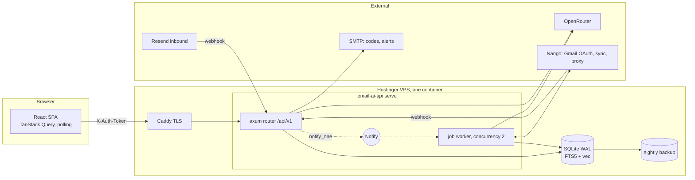

# 02 — Current Architecture (verified)

**Summary.** Post Room is one Rust process (axum API plus a tokio job worker) on one SQLite file, serving a React SPA, deployed by GitHub Actions to one Hostinger VPS behind Caddy. Mail arrives through Nango (Gmail) or Resend (forwarding). Every AI call goes through OpenRouter and is logged to a ledger. Agents are specs in a registry, routed by a pure function, executed one durable job per step, and gated by deterministic send checks. This document is the verified inventory as of commit `0e368c8` (14 Oct 2026): what exists, what is partial, what is missing, and how the parts talk to each other. Everything was read from source or run; nothing here comes from a plan document.

Verification run on 14 Oct 2026: `cargo test` 826 passed, 3 ignored (64 suites, 6.4 min); `pnpm typecheck` clean; `vitest` 291 passed.

---

## 1. Repository shape

```
email-agents/
├── apps/api/            Rust crate `email-ai-api` (edition 2024)
│   ├── src/             59,545 lines, 52 top-level modules
│   ├── tests/           60 integration test files, 18,256 lines
│   ├── migrations/      44 SQL files, 0001 to 0054 (numbering gaps are harmless)
│   └── Cargo.toml       axum 0.8, sqlx 0.8 (sqlite, migrate), tokio, reqwest (rustls), sqlite-vec 0.1.6
├── apps/web/            React 19 + Vite 8 + TanStack Query 5 + react-router 8 + Tailwind 4
│   ├── src/             26,037 lines, 25 feature folders, 49 Vitest files
│   └── e2e/             30 Playwright specs (99 real tests, 63 fixme stubs)
├── docs/                24 docs incl. architecture, features, api, evals, learn/ (9-module curriculum)
├── .github/workflows/   deploy.yml, e2e.yml, daily-selftest.yml
├── Dockerfile, compose.yml, Makefile, .env.example
└── integrations/nango/  empty
```

Velocity: 165 commits on 13 and 14 Oct 2026, almost all AI-generated. The learning gap is the owner's, not the code's.

---

## 2. Technology inventory

| Layer | Technology | Where | Status |
|---|---|---|---|
| HTTP | axum 0.8, tower-http (cors, trace, limit, fs) | `src/http/` 32 files, 156 routes | Live |
| Auth | Password + Argon2id + OTP email; OIDC JWKS; dev mode | `auth.rs`, `sessions.rs`, `http/auth_api.rs` | Live (password in prod) |
| DB | SQLite WAL, 8-connection pool, `BEGIN IMMEDIATE` everywhere, FTS5, sqlite-vec | `db.rs`, `migrations/` | Live |
| Jobs | Custom table queue, atomic claim, 120 s lease, backoff, dead letter | `jobs/` 13 files, 39 kinds | Live |
| Ingest | Resend inbound (Svix-signed), Nango Gmail (HMAC webhook + 5-min poll + backfill) | `sources/`, `http/webhooks.rs`, `ingest.rs` | Live |
| Send | Gmail via Nango proxy, attempt-id reconcile, undo window, hold | `replies.rs`, `messaging/email.rs` | Live |
| AI client | OpenRouter chat (strict json_schema), tool calling, embeddings, vision, ASR | `ai/openrouter.rs` 1,160 lines | Live; no streaming, no `cache_control` |
| Understanding | v1 classify + analyze + judges; v2 single call | `jobs/handlers.rs`, `ai/understand.rs` | v1 live, v2 shadow |
| Agents | Registry (specs, versions, 11 templates), routing, runner, 18 tools, critic, approvals, autonomy 0-3 | `agent_registry/`, `agents/` | Live |
| Designer | Plain English → spec → repair → dry run → versioned agent | `designer/` | Live |
| Assistant | "Ask Meera": 6-turn tool loop, plan cards, voice | `assistant/` | Live |
| Safety | Send checks, injection gate, leak check, learning guard, fencing | `send_safety.rs`, `agents/injection.rs`, `ai/fence.rs`, `learning/guard.rs` | Live |
| Learning | Signals, preferences, auto memory, context pack | `learning/`, `memory*.rs` | Live |
| Evals | 49 golden scenarios offline, live (ignored), understanding set, in-product safety and replay, promotion gate | `evals/`, `tests/golden_*.rs` | Offline passes; live baseline never run |
| HRMS pack | People, submissions, timesheets policy, portal reconciliation, escalation, matching | `team/`, `staffing/`, `matching.rs` | Live; timesheet records in a worktree |
| Observability | tracing (text), request ids, `ai_calls` ledger, `ai_incidents`, AI health page, daily self-test | `error.rs`, `ai_ledger.rs`, `incidents.rs`, `ai_health.rs` | Live; no metrics exporter |
| Web | Feature folders, `hooks.ts` per feature, one fetch wrapper, Tailwind tokens | `apps/web/src` | Live |
| Deploy | Actions → GHCR image → SSH → compose on host network `127.0.0.1:18090`, Caddy TLS | `.github/workflows/deploy.yml`, `compose.yml` | Live |
| Backup | Nightly `VACUUM INTO`, keep 7 | `backup.rs` | Live; restore never drilled |

---

## 3. System diagram



The API and worker share `AppState` (27 fields, `http/mod.rs:59`) and the pool. `jobs_notify` wakes the worker in-process; in split `api`/`worker` mode the worker falls back to a 1 s poll.

---

## 4. One email, end to end (as the code runs today, `UNDERSTAND_V2=off`)

```mermaid
sequenceDiagram
  participant G as Gmail/Nango
  participant W as Webhook
  participant J as jobs table
  participant K as Worker
  participant OR as OpenRouter
  participant UI as React
  G->>W: POST /webhooks/nango (HMAC)
  W->>J: BEGIN IMMEDIATE: inbound_events + sync job
  K->>G: sync_source: list + fetch bodies (8 concurrent)
  K->>J: persist_message (dedupe) + classify + extract_attachments jobs
  K->>K: classify_email: bulk filter (rules)
  alt bulk
    K->>J: file as newsletter; index only
  else not bulk
    K->>OR: embed query (label examples)
    K->>OR: classify (fast; escalate to V4 Pro if conf < 0.5)
    K->>J: persist_classification + analyze/index/extract jobs
    K->>OR: analyze (summary, asks, deadline)
    K->>OR: needs-reply judge (only on disagreement)
    K->>J: store_insight + workflow/automations/learn jobs
    K->>K: routing::route (pure) → message_routes
    opt auto_reply on and needs reply
      K->>J: case + agent_step:1
      K->>OR: planner turn + critic
      K->>OR: draft_email → drafter
      K->>J: approval, or held send (600 s)
    end
  end
  UI->>UI: poll /messages 5 s; /messages/{id} 3 s while processing
```

Deterministic: ingest, dedupe, bulk filter, routing, workflow step choice, send checks, autonomy gating, injection gate. Model calls: embed, classify, analyze, judge, memory extraction, draft, planner, critic, vision, ASR. Every call is listed in `05-agentic-system-design.md` §2.

---

## 5. Implemented, partial, missing

### Implemented and covered by tests
- Tenant-scoped API with membership checks on every `/workspaces/{ws}` route (`tests/tenant_isolation.rs` enumerates routes from source).
- Durable pipeline with idempotency keys at every stage (`inbound_events`, `(source_id, source_message_id)`, `jobs.dedupe_key`, `drafts.origin_key`, `send_attempt_id`).
- Two ingestion paths, one send path, undo and reconcile.
- Agent registry with versions, rollback, templates per pack, routing precedence manual > thread > rule > label > personal > generic > lead.
- Runner with per-turn durability, step and dollar caps, approvals with content hash, autonomy levels, automatic demotion.
- Designer with strict schema, lenient parse, repair loop, fallback model, dry run and save gates.
- Send safety: deterministic checks, leak check for automated sends, judge, one repair, hold, injection gate.
- Ledger with provider cost, cached tokens, schema failures as failures; incidents; AI health page; cost spike alerts.
- Learning: signals, guarded preferences, auto-memory with confidence caps.
- HRMS modules.

### Partial
- **Understanding v2**: shadow mode; `injection_signals` produced but never consumed; no `thread_state` or `contact_cards`.
- **Autonomy "earned" model**: the gate exists, but `seed::adopt_automatic_defaults` seeds level 3 for untouched workspaces (a product decision on 14 Oct; `docs/architecture.md` still says "explicit admin grant"). `AUTO_DRAFTS=false` means no cases auto-start by default, which limits the practical exposure.
- **Budgets**: the per-workspace daily cap gates analyze, learn, extract, automations and agent turns; drafts, indexing, the assistant and Jev calls sit outside it; the global cap covers classify and embed only; agent `spec.budget` is validated but never enforced at runtime.
- **Evals**: 49 scenarios pass offline; 95 scenarios and a scorecard exist uncommitted in the `wp-evals` worktree; the live baseline has never been run.
- **Timesheets**: parser and reader exist uncommitted in `wp-timesheets`; no `RecordTimesheet` step in `spec.rs` on main.
- **Agent builder UI**: trigger editing lives uncommitted in `wp-agentfix`.
- **Observability**: ledger and incidents yes; access logs at `info` no (TraceLayer defaults to DEBUG); no Prometheus or OpenTelemetry.

### Missing
- Members connecting their own Gmail.
- Thread model (open asks, commitments, waiting-on).
- Lease heartbeat and panic capture for jobs.
- Error boundary and runtime response validation in the web app.
- Backup restore drill; migrations on a production copy in CI.
- Billing. Microsoft 365.

---

## 6. How components communicate

| From | To | Mechanism | Contract |
|---|---|---|---|
| Browser | API | HTTPS JSON, `X-Auth-Token`, `/api/v1` | `docs/api.md`, `apps/web/src/api/types.ts` (hand-written, no runtime validation) |
| API handler | Worker | Insert into `jobs` in the handler's transaction, then `jobs_notify.notify_one()` | `jobs::kind::*`, JSON payload of ids |
| Worker stage | Next stage | Enqueue in the same transaction as the stage's write | dedupe keys like `analyze:{id}` |
| Worker or API | OpenRouter | reqwest, 45 to 65 s timeouts, strict JSON schema or tools, no streaming | `ai/openrouter.rs`, traits in `ai/mod.rs` |
| Nango | API | HMAC webhook; API calls the Nango proxy for Gmail reads and sends | `sources/nango.rs` |
| Resend | API | Svix-signed webhook; API fetches the email | `sources/resend.rs` |
| Any model call | Ledger | `task_local AiContext` set by middleware (HTTP) or the worker | `ai_ledger.rs` |
| Planner | Tools | Registry with JSON schemas, risk levels, per-spec allowlist | `agents/tools.rs:176` |
| Assistant | Actions | Plan cards in `assistant_plans`; confirm consumes once | `assistant/confirm.rs` |

---

## 7. Architectural choices and what they cost

| Choice | Benefit | Cost | Verdict |
|---|---|---|---|
| One process, one SQLite file | Zero infra, atomic data + job commits, trivial deploy | Single host; storage growth at 10k users (`06` §3.2); split mode loses `Notify` | Right for now; revisit at ~2,000 mailboxes |
| Hand-rolled job queue | Fits SQLite, idempotent by design | No heartbeat, no panic capture (`07` C1, C2) | Keep; fix the two gaps |
| Tenancy by handler convention | Simple | 159 manual calls; safety rests on a source-parsing test | Move to an extractor (`07` H3) |
| AI as trait objects chosen at startup | Tests swap doubles; no key means rules fallback | 270-line `build_state`; config naming traps (`OPENROUTER_MODEL_ID` does not control drafting) | Keep; tidy |
| Planner loop for inbox cases | Flexible | 4.5 calls per routine mail; latency | Workflow first, planner on escalation (`05`) |
| Polling SPA | No sockets | ~7 requests per 5 s per tab | SSE later |
| Strict json_schema, reasoning off | Cheap, parseable | Schema failures retried as transient | Classify failures (`07` H10) |

### Unnecessary complexity found
- Two send paths with duplicated `finalize_sent` and `job_err` (`replies.rs`, `messaging/email.rs`).
- `agents/` and `agents-hub/` web folders for two meanings of "agent".
- Shadow mode doubles classify spend while running; sample instead.
- Retired agents (Inbox Assistant, Diya, Tara) kept resolvable in templates.

### Can it scale economically?
Yes to about 1,000 mailboxes on one upgraded VPS with worker concurrency raised and the cost items in `06` §5 done (about ₹85 per mailbox per month). Beyond that, storage and backups of a 100 GB+ SQLite file are the forcing function, not CPU or model cost.

---

## 8. Where to look first

| Task | Start |
|---|---|
| Add an API route | `http/<area>_api.rs` `routes()`, merge in `http/mod.rs:177-189`, call `require_role`, run `cargo test --test tenant_isolation` |
| Change how mail is understood | `ai/understand.rs`, `jobs/handlers.rs::classify_email`, `tests/golden_understanding.rs` |
| Change what an agent may do | `agent_registry/spec.rs`, `agents/autonomy.rs`, `agents/tools.rs:176`, `tests/golden_offline.rs` |
| Add a model call | `OpenRouterClient::with_task("name")` so it lands in the ledger; add the task to `AUTOMATIC_TASKS` if it runs without a person |
| Add a job | `jobs/mod.rs::kind`, an arm in `handlers::handle`, a dedupe key, an idempotent handler |
| Add a page | `apps/web/src/features/<area>/`, `app/routes.tsx`, `app/nav.ts`, a `hooks.ts` |

---

## 9. Next steps

1. Read `07` for the ranked problems and the three-phase plan.
2. Merge or discard the four in-progress worktrees (`wp-agentfix`, `wp-evals`, `wp-timesheets`, `wp-testpack`) so this inventory stays true.
3. Update `docs/architecture.md` §5 and §7 (level-3 default, 49 scenarios) so the two documents agree.
