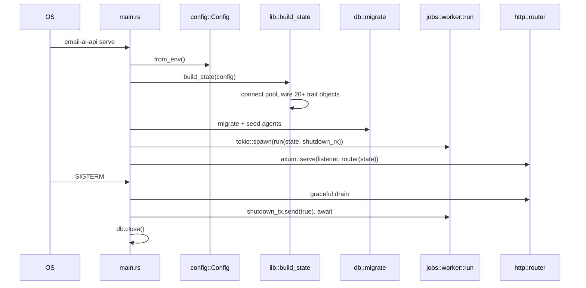
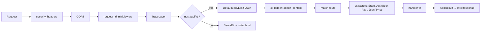

# 03 — Rust Backend Explained

**Summary.** `apps/api` is one Rust crate (edition 2024, about 59,500 lines in `src/`, 18,000 in `tests/`) that runs the HTTP API and the background worker in a single process on a single SQLite file. It is built on axum 0.8 for HTTP, sqlx 0.8 for SQLite, tokio for async, and reqwest for every outbound call. Every AI dependency is a trait object chosen at startup, which is how tests swap in doubles. This document explains the backend from first principles using the real files, then lists what to learn and how to check you learned it. The router section is the longest on purpose.

Paths are relative to `apps/api/src/` unless shown. Line numbers were correct on 14 Oct 2026 at commit `0e368c8`.

---

## 1. Startup: what happens when the process begins

File: `main.rs` (65 lines). Read it top to bottom; it is the whole lifecycle.



**A. What we built.** One binary with four modes: `serve` (default, API plus worker), `api`, `worker`, `migrate`. Modes are read from `std::env::args().nth(1)` with no CLI parser.

**B. Why.** One process on one VPS is the cheapest thing that works. The worker is a tokio task, not a second service, so there is no queue broker to run.

**C. How it works internally.**
- `Config::from_env()` (`config.rs:148`) reads about 85 environment variables. Empty strings count as unset. A bad number fails startup, which is correct: fail early, not on the first request.
- `build_state` (`lib.rs:73-342`) connects the pool and builds `AppState` (`http/mod.rs:59-102`), a 27-field struct of `Arc<dyn Trait>` values. Each AI port is picked by a `match` on whether a model id is configured: OpenRouter implementation, otherwise a rules or no-op fallback.
- `db::migrate` (`db.rs:71`) runs embedded migrations (`sqlx::migrate!("./migrations")` compiles the SQL files into the binary), then seeds agent templates.
- Shutdown uses a `tokio::sync::watch` channel. The HTTP server drains first, then the worker stops claiming and waits up to 30 s for running jobs (`jobs/worker.rs:61`). Anything cut off is recovered by lease expiry.

**D. Why this approach.** `AppState` is axum's dependency injection. Handlers receive it with `State(state): State<AppState>`; `#[derive(Clone)]` plus `Arc` fields makes the clone cheap (a pointer bump per field).

**E. Alternatives.** A `clap` CLI would validate the mode before doing work. Today `email-ai-api servee` runs migrations and seeds before failing at `main.rs:40`. Separate crates for domain and HTTP would shorten compile times; not worth it yet.

**F. Mistakes.** See §9: B8 (mode checked late), B9 (migrations run in every mode).

### Rust concepts here

- **Ownership and `Arc`.** `AppState` is cloned into every spawned task (`worker.rs:37`). Without `Arc`, each clone would deep-copy the HTTP client and pool. `Arc<T>` is a shared, reference-counted pointer; cloning it increments a counter. Question: why does `SqlitePool` not need an `Arc` wrapper? (It is already a cheap handle internally; check the sqlx docs for `Pool` being `Clone`.)
- **Trait objects.** `Arc<dyn Classifier>` means "any type that implements `Classifier`, decided at runtime". The trait in `ai/mod.rs:187` is one method: `async fn classify(&self, input: &ClassifyInput) -> Result<ClassifyOutput, AiError>`. `Send + Sync` bounds let it cross threads. `#[async_trait]` is needed because async fns in traits need boxing to be object-safe.
- **`?` and error propagation.** `main` returns `anyhow::Result<()>`; `.context("…")` from `anyhow` attaches a message as the error bubbles up.

---

## 2. The router, from first principles

File: `http/mod.rs:104-222`. This is the part to understand deeply.

### 2.1 What a router is

An axum `Router` is a value you build by chaining calls. Each `.route(path, method_router)` adds a mapping from (HTTP method, path pattern) to a handler function. Nothing runs until `axum::serve` hands the router a connection. Think of it as a table built at startup, then consulted per request.

### 2.2 How ours is assembled

Three routers are built and combined:

1. **`auth`** (`mod.rs:106-113`): six credential endpoints. `.route_layer(...)` wraps only these routes in a per-IP rate limit. `route_layer` differs from `layer`: it applies only to routes already added, not to the fallback.
2. **`api`** (`mod.rs:114-192`): about 70 inline routes, then `.merge(auth)`, then 13 `.merge(module::routes())` calls (each module file has `pub fn routes() -> Router<AppState>`), then a JSON 404 fallback, then two layers: `ai_ledger::attach_context` (labels AI spend by workspace from the URL) and a 256 KiB body limit.
3. **`app`** (`mod.rs:203-221`): health endpoints, two webhooks (the Resend one with its own 1 MiB limit), `.nest("/api/v1", api)`, then the SPA fallback (`ServeDir` with `index.html`), then four outer layers: trace, request id, CORS, security headers. Finally `.with_state(state)` turns `Router<AppState>` into `Router<()>`, which `axum::serve` accepts.

**Concept: `merge` versus `nest`.** `merge` combines two routers at the same prefix. `nest` mounts one under a prefix. The 13 feature modules use `merge` with full paths like `/workspaces/{ws}/automations`, so each module owns its complete path. That is why `grep '/workspaces/{ws}' http/*.rs` finds every tenant route, and why `tests/tenant_isolation.rs` can parse the source to find them.

**Concept: `Router<S>` and state.** Until `.with_state`, the router is generic over the state type it will need. A module's `routes()` returns `Router<AppState>`; merging routers with the same `S` is allowed. Question: what compile error do you get if a module returns `Router<()>` and you merge it before `with_state`? Try it.

### 2.3 How a request flows through the layers

Layers in tower are middleware. Order matters and is the reverse of reading order: the last `.layer()` added is the outermost, so a request enters `security_headers` first, then CORS, then request id, then trace, then the route. Responses leave in the opposite order.



`request_id_middleware` (`error.rs:21-35`) shows the shape of a `from_fn` middleware: take `Request` and `Next`, do work, call `next.run(req).await`, post-process the response. It also opens a tracing span and stores the id in a `tokio::task_local!`, which is how `AppError::into_response` can include `request_id` in the JSON body without being passed it.

### 2.4 Extractors: how arguments reach a handler

Look at `request_draft` (`http/messages.rs:629-634`):

```rust
pub async fn request_draft(
    State(state): State<AppState>,
    user: AuthUser,
    Path((ws, id)): Path<(String, String)>,
    body: Bytes,
) -> AppResult<(StatusCode, Json<Value>)>
```

Each parameter is an extractor: a type implementing `FromRequestParts` (reads headers and path) or `FromRequest` (consumes the body; must be last). axum runs them in order before calling the handler. If one fails, its `Rejection` becomes the response and the handler never runs.

`AuthUser` is our own extractor (`auth.rs:189-196`). Its `from_request_parts` reads `X-Auth-Token` or `Authorization: Bearer`, then `state.auth.authenticate(&db, token)`. In password mode that is a session lookup by SHA-256 hash (`sessions.rs`). The rejection type is `AppError`, so a missing token becomes a 401 JSON error automatically. `ClientIp` (`security.rs:63-72`) is a second example, with `Infallible` rejection.

**There is no auth middleware.** Authentication happens because the handler asks for `AuthUser`. Authorisation happens because the handler calls `require_role(&db, &ws, &user, Role::Operator)` (`auth.rs:236-248`). That is 159 manual calls across the codebase. One forgotten call leaks data across tenants; the only guard is `tests/tenant_isolation.rs`, which calls every `/workspaces/{ws}` route as a member of another workspace and expects 403 or 404. Question for you: how would you make the compiler enforce this instead? (Hint: an extractor `Member { ws, role, user }` that does the lookup in `from_request_parts`, so a handler cannot get a workspace id without proof.)

### 2.5 Responses and errors

Handlers return `AppResult<T>` = `Result<T, AppError>` (`error.rs:121`). Any `T: IntoResponse` works: `Json<Value>`, `(StatusCode, Json<…>)`, `StatusCode`. `AppError` (`error.rs:37-74`) is a `thiserror` enum; its `IntoResponse` (`error.rs:85-119`) maps each variant to a status and a stable `code` string, logs `Internal` errors server-side and hides their text from clients. `From<sqlx::Error>` maps `RowNotFound` to 404 and everything else to 500, so `?` on a query just works.

**Concept: `Result` is the control flow.** There are no exceptions. Every fallible call returns `Result`, `?` returns early on `Err`, and `From` impls decide how a low-level error becomes an HTTP status. Question: what status does a handler return if a query hits `SQLITE_BUSY` after the 15 s timeout? Trace it: `sqlx::Error::Database` → `Internal` → 500.

### 2.6 Validation

There is no validator crate. Handlers deserialize with serde and check by hand (`request_draft` parses `Bytes` manually so an empty body is allowed, `messages.rs:637-641`). Domain specs are validated in their own modules (`agent_registry/spec.rs` rejects unknown fields with `deny_unknown_fields`, `designer/validate.rs`). This is fine at this size; the risk is inconsistency.

---

## 3. Database: SQLite done carefully

File: `db.rs` (112 lines).

- Pool: WAL journal, `synchronous=NORMAL`, foreign keys on, `busy_timeout` 15 s, 8 connections, file created `0600`.
- The sqlite-vec extension is registered process-wide with an `unsafe` `transmute` (`db.rs:15-26`). This is the only `unsafe` in the codebase and it is the standard way to load a static SQLite extension through sqlx's bundled library.
- Migrations: 44 files, embedded at compile time, applied on every start. sqlx refuses to start if an applied migration's checksum changed, so applied migrations are never edited.

**The one rule that keeps SQLite happy.** Every write transaction starts with `begin_with("BEGIN IMMEDIATE")` (143 occurrences, 0 plain `.begin()`). SQLite has one writer at a time. A transaction that reads first and writes later must upgrade its lock and can fail with `SQLITE_BUSY` instead of waiting. `BEGIN IMMEDIATE` takes the write lock up front, so writers queue behind `busy_timeout` instead of failing. `tests/db_concurrency.rs` stresses this.

**Pattern example.** `persist_classification_with` (`jobs/handlers.rs:528-640`): open `BEGIN IMMEDIATE`, upsert the classification with an `ON CONFLICT … WHERE` clause that makes "manual wins over model" atomic, update the message status with `RETURNING`, write an audit row, enqueue the next job, commit. Everything that must be true together is in one transaction, and no network call happens inside it (the model call happened before).

**No repository layer.** SQL lives in three styles: inline in handlers (23 of 32 `http/*.rs` files run queries), store modules with typed rows (`agent_registry/store.rs` takes `impl SqliteExecutor`), and domain modules owning their SQL (`jobs/mod.rs`, `ingest.rs`). No compile-time `query!` macros are used, so SQL typos are runtime errors caught by tests.

**Concept: transactions and the borrow checker.** `tx` is `Transaction<'_, Sqlite>`; queries take `&mut *tx`. Dropping `tx` without `commit` rolls back. Functions like `ingest::persist_message` take `&mut SqliteConnection` so the caller decides the transaction boundary. Question: why does `jobs::enqueue` take a connection and not the pool? (So a stage's result and its next job commit together or not at all.)

---

## 4. Background jobs: a durable queue in one table

Files: `jobs/mod.rs` (300 lines), `jobs/worker.rs` (171), `jobs/handlers.rs` (1,514).

**A. What we built.** A `jobs` table (`migrations/0001_core.sql:95`, `0018_job_priority.sql`) with `dedupe_key UNIQUE`, `status` in pending/running/succeeded/dead, `attempts`, `max_attempts`, `run_at`, `locked_until`, `locked_by`, `priority`. 39 job kinds dispatched by a single `match` in `handlers::handle` (`handlers.rs:117-165`).

**B. Why.** Email processing is a pipeline of slow, failure-prone steps (fetch from provider, call a model, send through Gmail). Each step must survive crashes and be retried without duplicating side effects. A table in the same database as the data lets a step's output and the next step's job commit atomically.

**C. How it works.**
- **Enqueue** (`jobs/mod.rs:118-149`): `INSERT … ON CONFLICT(dedupe_key) DO UPDATE … WHERE jobs.status = 'dead'`. A duplicate key is a no-op; a dead job with the same key is revived. Priority is computed by kind, with a bonus for mail received in the last 48 h.
- **Claim** (`jobs/mod.rs:186-207`): one atomic `UPDATE … WHERE id = (SELECT … ORDER BY priority DESC, run_at LIMIT 1) RETURNING …`. Because it is a single statement, two workers cannot both take the same job. It also picks up jobs whose 120 s lease expired.
- **Fencing** (`complete`, `fail`): `WHERE locked_by = ? AND attempts = ? AND status = 'running'`. A stale task that lost its lease cannot overwrite a re-claimed job's state.
- **Backoff** (`backoff_ms`): 2 s doubling, capped at 5 min, with jitter. `fail` sets `pending` with a future `run_at`, or `dead` when permanent or exhausted. `on_dead` (`handlers.rs:168`) runs per-kind compensation so a failure is visible (a dead classify files the mail under `other` with review).
- **Worker loop** (`worker.rs:14-63`): acquire a semaphore permit (concurrency default 2), claim, `tokio::spawn(process)`. When idle, wait on `jobs_notify` (woken by handlers after enqueue) or a 1 s poll. Every 30 s, `maintenance` enqueues scheduled work (Gmail polls, alert evaluation, agent ticks, backups).
- **Cost gate** (`handlers.rs:58-107`): AI stages on old mail or over budget return `Ok(())` early and are marked `succeeded` without running; opening the email later runs them for real.

**D. Why not a queue service.** At this scale (one host, tens of thousands of emails a month) SQLite handles the claim rate easily. Redis or RabbitMQ would add an operational dependency and lose the atomic "data plus job" commit.

**E. Alternatives.** `apalis` (Rust job framework) offers the same model with more features; Temporal offers durable workflows but needs its own server. The current design is a reasonable hand-rolled subset; the gaps are listed in §9 (no lease heartbeat, panics not caught).

### Rust concepts here

- **`tokio::spawn` and `'static`.** The spawned future must own everything it uses, which is why `state.clone()` and `worker_id.clone()` happen before `async move` (`worker.rs:37-42`).
- **`Semaphore` and `OwnedSemaphorePermit`.** `acquire_owned` returns a permit that can move into the task; dropping it releases concurrency.
- **`tokio::select!`.** Races the notify, the sleep and the shutdown signal; the first to finish wins and the others are cancelled.
- **Cancellation safety.** If shutdown fires mid-job, the job is not killed; the loop stops claiming and waits up to 30 s. A job interrupted by process death is recovered by lease expiry, which is why handlers must be idempotent (stated at `jobs/mod.rs:1`).

---

## 5. Async execution and concurrency rules the code follows

- **Never hold a transaction across a network call.** Stated in `README.md` and followed (`handlers.rs:265`, `compose_draft`). A model call can take 20 s; holding SQLite's write lock that long would block every other write.
- **CPU-bound work goes to `spawn_blocking`.** Argon2 password hashing (`sessions.rs:49`, limited to 4 at once by a semaphore), PDF and spreadsheet parsing (`attachments/mod.rs:161`). Blocking the tokio runtime thread stalls every other task on it.
- **Bounded fan-out.** Gmail enrichment uses a `JoinSet` with 8 concurrent fetches (`sources/nango.rs:899`).
- **Known violations:** `backup.rs:36-70` uses `std::fs` inside async (nightly job, short); `team/people.rs::import_csv` parses CSV synchronously inside an async fn.

**Concept: the runtime is cooperative.** A tokio task yields only at `.await`. A long synchronous loop or blocking syscall starves the other tasks on that worker thread. Question: with `JOB_WORKER_CONCURRENCY=2` and a multi-threaded runtime, how many OS threads does the process use? (Tokio's default is one worker thread per core plus a blocking pool; the semaphore limits jobs, not threads.)

---

## 6. Ingestion and sending

- **Resend webhook** (`http/webhooks.rs:22`): Svix signature check (`sources/resend.rs:34`, HMAC-SHA256 over `id.ts.body`, 5 min tolerance, constant-time compare). In one `BEGIN IMMEDIATE`: `INSERT OR IGNORE INTO inbound_events` (unique per provider event) and enqueue `fetch_forwarded_email` with 12 attempts. The webhook does no other work, so it returns 2xx fast and the provider never retries because of our slowness.
- **Nango webhook** (`webhooks.rs:84`): HMAC over the raw body with rotatable secrets; no timestamp window (dedupe by body hash only; see B23).
- **Sync** (`sources/nango.rs:647`): one-time bounded backfill, then incremental `after:` queries, 50-row chunks each in their own transaction, cursor advanced with the last chunk.
- **Sending** (`replies.rs:509`, `send_draft_held`): refuse `[NEEDS]` gaps, check capabilities, reconcile any previous attempt against Gmail before retrying (a durable attempt id is used as the Message-ID), run `send_safety::check`, allow one automatic repair, then schedule a `send_draft` job after the undo window. SMTP (`mailer.rs`) is only for verification codes and alerts; user mail goes out through the owner's Gmail via Nango.

**Concept: idempotency keys.** `(provider, provider_event_id)`, `(source_id, source_message_id)`, `jobs.dedupe_key`, `drafts.send_attempt_id`. Each one answers "if this happens twice, how do we notice?". Exercise 4 makes you add one.

---

## 7. Configuration, secrets, observability, tests

- **Config:** env only; `.env` is git-ignored; `AI_MOCK` and dev auth are refused outside local conditions (`config.rs:327-370`). `Config` derives `Debug` with plaintext secrets (B25).
- **Logging:** `tracing_subscriber::fmt` plain text, `info` default. Spans per request (`request_id`, method, path) and per job (`job_id`, kind, attempt). No metrics exporter; the product's own `ai_calls` ledger and `ai_incidents` are the observability that exists, surfaced on the AI health page.
- **Tests:** 820 test functions. Integration tests build a real file-backed SQLite in a temp dir, call the router in-process with `tower::ServiceExt::oneshot`, drain jobs with `worker::drain`, and mock Gmail, Nango and Resend with local axum servers. Shared helpers in `tests/common/mod.rs`. Full suite result is recorded in `07`.

---

## 8. A full request, traced: send a reply

| Step | File and function | Responsibility | Fails how |
|---|---|---|---|
| 1 | `POST /api/v1/workspaces/{ws}/drafts/{id}/send` → `http/mod.rs:148` | Route match | 404 JSON |
| 2 | `replies::send` (`replies.rs:605`) | Extract `AuthUser`, `Path`, body `{confirm}`; `require_role` Operator | 401 / 403 |
| 3 | `replies::send_draft_held` (`replies.rs:509`) | Load draft scoped by `ws`; refuse if sent or scheduled; refuse `[NEEDS]`; check source can send | 409 `conflict` / `send_blocked` |
| 4 | `replies::reconcile` (`replies.rs:287`) | If a previous attempt exists, ask Gmail whether it went out | 409 "still confirming" |
| 5 | `send_safety::check` (`send_safety.rs`) | Deterministic checks plus a judge model call (cached in `judge_cache`) | 409 `send_blocked` with `blocking[]` |
| 6 | `BEGIN IMMEDIATE`: set `send_at`, `send_attempt_id`, audit row, enqueue `send_draft` at `now + undo` | Durable schedule | 500 on DB error |
| 7 | Response `ScheduledSend { send_at }` | UI shows the countdown | — |
| 8 | Worker: `replies::send_scheduled` (`replies.rs:734`) → Nango Gmail `messages/send` with the attempt id as Message-ID → `finalize_sent` | Actual send | Retry with backoff; `give_up_scheduled` on dead |

Weaknesses: `finalize_sent` and `job_err` exist twice (`replies.rs`, `messaging/email.rs`) for the two send paths; the judge call inside step 5 makes the HTTP request wait on a model (bounded by the 45 s reqwest timeout).

---

## 9. Mistakes and weaknesses (backend)

Severity scale is in `07`. CONFIRMED means read in the code.

| # | Sev | Issue | Where | Why it matters | Fix | Test |
|---|---|---|---|---|---|---|
| B1 | Critical | No lease heartbeat; fixed 120 s lease | `jobs/mod.rs:22`, `worker.rs` | A job longer than 120 s (a 50-page Gmail sync, a live eval, a slow planner turn) is re-claimed and runs twice; fencing protects the row, not the side effects | Heartbeat task extends `locked_until` every 30 s while the handler runs; or per-kind lease lengths | Test with a handler that sleeps 130 s under a 1 s lease and assert single execution |
| B2 | High | A panic inside a job is not caught | `worker.rs:39` | The job stays `running` until the lease expires; no error is recorded; dead-letter never fires on a deterministic panic | Wrap `process` in `tokio::spawn` + `JoinHandle` result check, or `std::panic::AssertUnwindSafe` + `catch_unwind`; record `last_error` | A test handler that panics; assert `last_error` and retry |
| B3 | High | Tenancy by convention: 159 manual `require_role` calls | `auth.rs:236`, every `http/*.rs` | One forgotten call leaks another workspace's data | A `Member` extractor that resolves membership in `from_request_parts`; handlers take `Member` instead of `Path<ws>` | `tests/tenant_isolation.rs` stays as the net |
| B4 | High | Nango webhook has no replay window | `http/webhooks.rs:84`, `sources/nango.rs:283` | A captured body can be replayed after the dedupe row is purged | Require and check a timestamp header if Nango provides one; otherwise keep dedupe rows for the retention period | Replay test |
| B5 | Medium | `maintenance` runs inline in the claim loop and scales per workspace per 30 s | `worker.rs:105-171` | Slow maintenance delays job claims; 5+ schedulers each `SELECT id FROM workspaces` | Run maintenance in its own task; one workspace scan shared by schedulers | Time the loop with 1,000 workspaces |
| B6 | Medium | N+1 queries | `messaging/teams.rs:22`, `messaging/watch.rs:717`, `assistant/history.rs:171` | Latency grows with rows | JOIN or `IN (...)` batch | Query count assertion in a test |
| B7 | Medium | Inbox search is a `LIKE` scan over bodies | `http/messages.rs` `list` | Slow past a few thousand mails although FTS5 exists in `knowledge.rs` | Use the FTS index for `q` | Timing test on 10k rows |
| B8 | Low | Unknown mode fails after migrations and seeding | `main.rs:14-40` | Surprising side effects on a typo | Validate the mode first; consider `clap` | — |
| B9 | Low | Migrations and seeding run in every mode | `main.rs:18` | In split `api`/`worker` mode both run them concurrently | Run only in `serve`/`migrate`; others verify the version | — |
| B10 | Low | 143 copies of `begin_with("BEGIN IMMEDIATE")` | everywhere | A plain `.begin()` sneaking in is a latent `SQLITE_BUSY` | `db::write_tx(&pool)` helper; a clippy-style grep in CI for `.begin()` | CI grep |
| B11 | Low | `build_state` is 270 lines of repeated wiring | `lib.rs:73` | Hard to read; adding a port means editing a wall of `match` | A small `pick_model(&[ids])` helper and per-port constructors | — |
| B12 | Low | Duplicated helpers | `str_field` ×3, `workspace_of` ×2, `job_err` ×2, `finalize_sent` ×2 | Drift between copies | Move to `jobs/mod.rs` and a shared send module | — |
| B13 | Low | `Config: Debug` with plaintext secrets | `config.rs:37` | One `{:?}` log leaks keys | Wrap secrets in a `Secret<String>` newtype with a redacting `Debug` | Unit test on `format!("{:?}")` |
| B14 | Low | `Mutex::lock().expect(...)` on the login limiter | `sessions.rs:178-248` | A poisoned mutex panics every auth request | `parking_lot::Mutex` or `lock().unwrap_or_else(|e| e.into_inner())` | — |
| B15 | Low | AI spend attributed from the URL before authorisation | `ai_ledger.rs:116` | Mislabelled spend on a 403 (no AI call actually happens) | Attach context after `require_role`, or in the handler | — |
| B16 | Low | Blocking `std::fs` in async | `backup.rs:36-70` | Stalls a runtime thread during the nightly backup | `tokio::fs` or `spawn_blocking` | — |

---

## 10. What to learn, in order

1. **Ownership, borrowing, `Arc`, `Clone`** — `AppState`, `worker.rs:37`. Rust Book ch. 4 and 15.
2. **`Result`, `Option`, `?`, `From`, `thiserror`, `anyhow`** — `error.rs`. Rust Book ch. 9; `thiserror` and `anyhow` docs.
3. **Traits, generics, trait objects, `async_trait`** — `ai/mod.rs:187`, `lib.rs:94`. Rust Book ch. 10 and 18.
4. **async/await, tokio tasks, `select!`, semaphores, `spawn_blocking`** — `worker.rs`, `sessions.rs:49`. Tokio tutorial.
5. **axum: Router, extractors, `IntoResponse`, `from_fn` middleware, state** — `http/mod.rs`, `auth.rs:189`, `error.rs:21`. axum docs and examples.
6. **sqlx with SQLite: pools, transactions, `RETURNING`, WAL, `BEGIN IMMEDIATE`** — `db.rs`, `jobs/mod.rs`. sqlx docs; SQLite "Write-Ahead Logging" and "Transaction" pages.
7. **Production patterns: idempotency, leases, backoff, dead letters** — `jobs/mod.rs`. Read "Designing Data-Intensive Applications" ch. 11 after the code.

Official docs: [Rust Book](https://doc.rust-lang.org/book/) · [Tokio tutorial](https://tokio.rs/tokio/tutorial) · [axum](https://docs.rs/axum/latest/axum/) · [sqlx](https://docs.rs/sqlx/latest/sqlx/) · [SQLite WAL](https://www.sqlite.org/wal.html) · [SQLite transactions](https://www.sqlite.org/lang_transaction.html) · [thiserror](https://docs.rs/thiserror) · [anyhow](https://docs.rs/anyhow).

---

## 11. Exercises

1. **Ownership.** In `worker.rs:35-43`, remove `let state = state.clone();` and compile. Read the error. Explain in two sentences why `tokio::spawn` needs an owned value.
2. **Errors.** Add an `AppError::Gone` variant mapped to 410. Use it in one handler. Write one `oneshot` test asserting the JSON `code`.
3. **Extractors.** Write `Member { ws: String, role: Role, user: AuthUser }` implementing `FromRequestParts<AppState>` that calls `require_role` with `Role::Operator`. Convert `reviews::list` to use it. Run `cargo test --test tenant_isolation`.
4. **Transactions and idempotency.** Add a new job kind `ping` that writes one audit row. Enqueue it twice with the same dedupe key inside one transaction. Prove with a test that one row exists. Then make the handler panic and observe what `/jobs` shows after 120 s (this is B2).
5. **Async.** Change `JOB_WORKER_CONCURRENCY` to 1 and run `tests/db_concurrency.rs`. Predict the effect on runtime before running.
6. **Routing.** Add `GET /workspaces/{ws}/ping` in a new `http/ping_api.rs` with `routes()`. Merge it. Forget `require_role` on purpose and watch `tests/tenant_isolation.rs` fail. Then fix it.
7. **SQL.** Run `EXPLAIN QUERY PLAN` on the claim query (`jobs/mod.rs:189`) against a copy of the production DB. Does it use `idx_claim_jobs_priority`? (Answers B15 hypothesis.)

**Three understanding questions:**

- Why must the first statement in every transaction be a write, and what happens to a transaction that reads first under load?
- A job's `complete` runs `WHERE attempts = ?`. Describe the exact sequence of events that this clause protects against.
- `AuthUser` is an extractor and `require_role` is a function call. Which one can the compiler force you to use, and why does that matter for tenant safety?

---

## 12. Next steps

- Fix B1 and B2 first; both are inside `jobs/` and have clear tests.
- Introduce the `Member` extractor (B3) one module at a time, starting with `reviews.rs` (smallest).
- Add `db::write_tx` (B10) and a CI grep that fails on plain `.begin()`.
