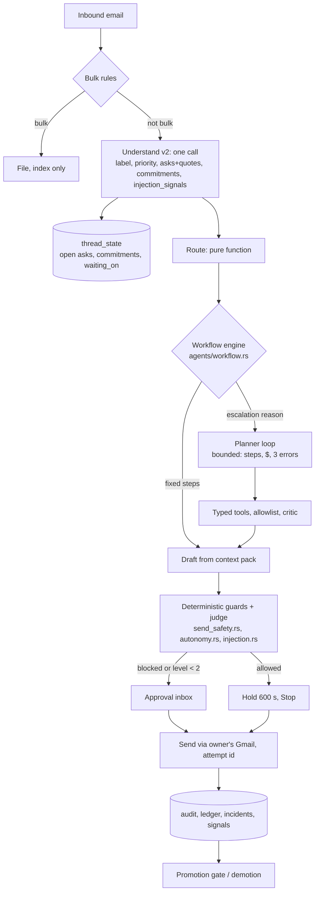
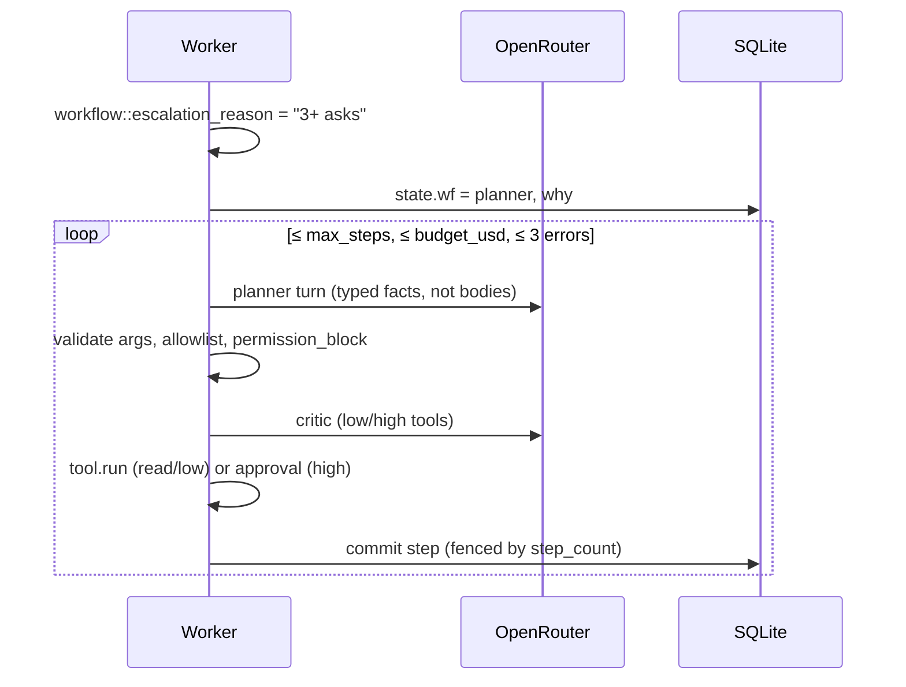

# 05 — Agentic System Design

**Summary.** Post Room already runs a hybrid: deterministic workflows for known mail types, a bounded planner loop (one durable job per turn, 18 typed tools, a critic, approvals) for the rest, and deterministic guards on every side effect. That is the right shape. The recommendation is not a new architecture but a tightening: make the **workflow engine with AI steps** the default for every inbox case, keep the **planner as an escalation path** for the unpredictable 5 to 10%, add a thread model, close the budget and fencing gaps, and never adopt multi-agent cooperation. This document evaluates the current implementation call by call, compares five alternatives against measurable needs, and specifies the target with diagrams and production controls mapped to real files.

Paths are under `apps/api/src/`. Line numbers are from 14 Oct 2026, commit `0e368c8`.

---

## 1. What exists today (evaluated, not assumed)

### 1.1 The pieces

| Concern | Implementation | Verdict |
|---|---|---|
| Intent and classification | Rules bulk filter (`bulk.rs`), then `classify` (fast model, escalation below 0.5 confidence), then `analyze` (summary, asks, deadline), then a needs-reply judge on disagreement. v2 merges these into one call (`ai/understand.rs`, shadow) with quote verification in code. | Good design; v2 should take over |
| Routing | Pure function `agent_registry/routing.rs::route` (l.176): manual > thread > rule > label > personal > generic > lead. No model. | Correct; keep deterministic |
| Planning and execution | `agents/runner.rs::run_step`: one `AGENT_STEP` job per turn, fenced by `step_count`, state in `cases.state_json` and `case_steps`. `workflow::decide` chooses fixed steps for workflow-mode agents and hands over to the planner on complaint, legal wording, 3+ asks, several parties, reopened thread, declined draft, failed step (`workflow.rs:148-198`). | Right pattern; the planner still runs for most "agent"-mode templates (Meera, Ishaan, Kabir) on routine mail |
| Tools | 18 tools with JSON schemas and risk levels read/low/high (`agents/tools.rs:176-197`); per-spec allowlist; critic before low and high; `critic::hard_rules` before sends. | Good |
| Memory and context | `memory::context_with` (contact 10, FTS 5, workspace 20, 2,500 bytes), preferences (≤ 6, 900 chars), 3 past replies, thread digest (4 × 180 chars), email ≤ 6,000 chars, insight. Planner prompt: case header, all step summaries, last 8 steps in detail, facts ≤ 2,000 chars. | Budgets exist; no thread state; planner sees subject and sender unfenced |
| Human approval | `agent_approvals` with a content hash covering recipient, subject, body; edit-then-approve; decline writes a learning signal. Assistant actions are plan cards consumed once. | Good; apply is not atomic (§5) |
| Scheduling and async | `schedule_check` sleeps a case up to 14 days; `wake_for_thread` on a reply; 15-min schedule ticks. | Good |
| Failure recovery | Job retry 5× with backoff; 3 consecutive error turns fail a case; planner refusal fails the case and logs an incident; dead-letter compensation per kind. | Good, minus the lease heartbeat and panic capture (`07` C1, C2) |
| Observability | `ai_calls` per call with task, tokens, cost, cached tokens, schema_ok; `ai_incidents` eight kinds; AI health page; spike alerts. | Good; case spend undercounts (§5) |
| Evaluation | 49 offline scenarios with a scripted planner and canned drafter; in-product safety and replay runs gate promotions; live suite exists but never run. | Offline tests only deterministic gates; model quality is unmeasured |
| Multi-tenant isolation | `workspace_id` on every table; `require_role` per handler; tool reads scoped (`case::get_in`, `message_in_ws`). | Holds; by convention |
| Autonomy | Levels 0-3, effective level = min(earned, admin cap, spec max, env, profile); fixed floor (new recipients, forwards, attachments, money or legal wording, `[NEEDS]`, injection); 600 s hold; automatic demotion. | Strong, but level 3 is seeded by default |

### 1.2 Every model call on the inbox path

| # | Call | Model | When | File |
|---|---|---|---|---|
| 1 | Embed label-example query | bge-m3 | every non-bulk email | `knowledge.rs:395` |
| 2 | Classify (+ escalation) | qwen3.8-flash → V4 Pro | every non-bulk email | `ai/openrouter.rs:711` |
| 3 | Analyze | qwen3.8-flash | every non-bulk email | `openrouter.rs:855` |
| 4 | Needs-reply judge | qwen3.8-flash | on disagreement | `jobs/handlers.rs:1385` |
| 5 | Index embeddings | bge-m3 | every email, batched | `knowledge.rs:246` |
| 6 | Memory extraction | qwen3.8-flash | non-noise mail | `ai/memory_extractor.rs:189` |
| 7 | Vision / ASR | qwen3-vl / qwen3-asr | images, audio | `attachments/` |
| 8 | Planner turn | tier model (balanced = V4 Flash) | ~4.5 per case | `agents/planner.rs` |
| 9 | Critic | qwen3.8-flash | ~2 per case | `agents/critic.rs` |
| 10 | Draft | V4 Flash / V4 Pro | per draft | `openrouter.rs:586` |
| 11 | Send-safety judge | qwen3.8-flash | per check and at fire time | `send_safety.rs:592` |
| 12 | Reply memory + draft lessons | V4 Flash | per approved draft | `jobs/learning_jobs.rs` |

Calls 2, 3, 4 and 6 read the same email; v2 replaces them with one. Calls 8 and 9 are the planner's cost on routine mail.

---

## 2. Requirements to design against (measurable)

| Need | Measure | Today | Target |
|---|---|---|---|
| Correct label and needs-reply | agreement with human labels | keyword baseline 58%; model unmeasured live | ≥ 90% on a 200-email set |
| Time from email to draft ready | p95 | ~15 to 30 s (estimate) | ≤ 15 s |
| Cost per email, agents on | ledger | ≈ ₹0.11 | ≤ ₹0.05 |
| Nothing leaves without a person unless allowed | safety invariants | 49/49 offline | 100% offline and live |
| Resume after crash with no duplicate side effect | tests | fenced steps; approval apply not atomic | atomic |
| Operator can explain any action | audit + steps | yes | keep |

---

## 3. Alternatives compared

| Option | Correctness | Latency | Cost per routine mail | Operational complexity | Fit |
|---|---|---|---|---|---|
| 1. Single agent with tools | Depends on the model every time; hard to test | 4 to 6 calls | high | low | Rejected for routine mail; this is what the inbox case does today |
| 2. Router + specialised agents | Better prompts per domain; still a loop per mail | same as 1 | high | medium | Rejected as default; routing already exists without a loop |
| **3. Workflow engine with AI-powered steps** | Deterministic order; model only where judgement is needed (understand, draft, judge) | 2 to 3 calls | lowest | low (already built: `agents/workflow.rs`, `Step` enum) | **Default** |
| **4. Planner-executor** | Flexible for multi-step cases (requirements, escalations) | many calls | high | medium (already built: `runner.rs`) | **Escalation path only** |
| 5. Multiple cooperating agents | Hard to bound; failure modes multiply; no measurable need | worst | worst | high | Rejected |

Decision rule: a step runs under the workflow engine unless `workflow::escalation_reason` fires. This matches Anthropic's guidance (workflows for predictable steps, agents only where steps are unpredictable) and the owner's cost goal.

---

## 4. Target architecture

### 4.1 Components



What changes versus today is small: v2 on, `thread_state` added, workflow-first for every inbox case, and the planner only on escalation. Everything else exists.

### 4.2 Sequence: routine reply

```mermaid
sequenceDiagram
  participant K as Worker
  participant OR as OpenRouter
  participant DB as SQLite
  participant P as Person
  K->>OR: understand (V4 Flash, cached prefix)
  K->>DB: insight + thread_state + route (one tx)
  K->>K: workflow::decide → Draft
  K->>OR: draft (V4 Flash) from context pack
  K->>K: check_draft → [NEEDS] gaps
  K->>K: send_safety deterministic + autonomy floor
  alt automated and level ≥ 2
    K->>OR: judge (cached)
    K->>DB: schedule send +600 s, audit agent.send_held
    P-->>K: Stop (optional)
  else
    K->>DB: approval row; case waiting_approval
    P->>K: approve / edit / decline
  end
  K->>DB: send job → Gmail with attempt id → finalize_sent
```

Two model calls on the happy path (understand, draft), a third only for automated sends.

### 4.3 Sequence: escalation to the planner



---

## 5. Production concerns mapped to code

| Concern | Today | Gap | Change |
|---|---|---|---|
| Tool permissions, least privilege | Per-spec allowlist (`case_agent.allowed_tools`), scopes drop tools (`designer/validate.rs:233`), `permission_block` | `send_message` and `notify_owner` have no dedupe token | Add idempotency keys to both (`messaging/inapp.rs`, `dispatch.rs`) |
| Prompt injection and untrusted data | `fence()` with defanged tags on classify, analyze, understand, draft, learn; datamarking in `read_email` excerpts and the assistant; 12-pattern injection gate forcing approval; learning guard | Critic prompt and planner `case.title`, `goal`, `state_json`, `insight` are unfenced (`critic.rs:160`, `runner.rs:57-94`, `tools.rs:370`); Jev path raw; `injection_signals` never read; `prepare_text` redacts "I can't reset my password" lines | Fence those fields; consume `injection_signals` into `injection_suspected`; narrow the redaction regex to `key: value` shapes |
| Approval before external side effects | High-risk tools create approvals; hash covers content; assistant plan cards | `approvals::decide` commits, then runs the tool, then writes the step in a second tx (`approvals.rs:~250-290`) | Record "approved, pending apply" in the first tx; apply; mark applied; a sweeper retries un-applied approvals |
| Idempotency and duplicates | Keys on every stage; `drafts.origin_key`; `send_attempt_id` reconcile; `create_task` NOT EXISTS | Tool run happens before `commit` (`runner.rs:433, 514`); retries can duplicate `notify_owner`/`send_message` | Same as row 1 |
| Agent loops and limits | `max_steps` 15, `budget_usd` 0.10, `MAX_ERROR_STREAK` 3, shadow 4 steps | `spec.budget` never enforced (`case.rs:243`); case spend omits draft and read_email costs (`tools.rs:711`, `runner.rs:516`); planner cost fallback $1/$5 per M | Bind spec budget in `case::create`; add tool costs to `Usage`; use ledger price table |
| Context-window management | Char caps per block; `render_prompt` stable-first; `DETAILED_STEPS` 8, `OUTPUT_CHARS` 900 | Planner tool results carry bodies up to 3,000 chars; `understand` does not pre-truncate the body before attachments | Typed fields in tool results; truncate body first |
| Model timeouts and fallbacks | 45 to 65 s per call; classifier escalation; designer fallback model; rules fallbacks at startup and over budget | No in-client retry; schema failures are `Retryable` and re-bill up to 5× | One repair turn for schema/validation failures, then `Permanent` |
| Structured tool outputs | `tools.rs` returns `ToolOutput` with summary and typed JSON | `read_email` returns raw subject and insight | Fence or type them |
| Durable execution and checkpoints | One job per turn, `cases` + `case_steps`, fenced commit | 120 s lease with no heartbeat; a classify (embed + classify + escalation) can reach 120 s | Heartbeat task per running job; per-kind lease |
| Tenant data boundaries | `workspace_id` everywhere; `tests/tenant_isolation.rs` | `thread_digest` does not filter `suppressed` (`handlers.rs:1273`, HYPOTHESIS) | Add the filter; a `Member` extractor (`03` B3) |
| Budgets | Per-workspace daily cap on some tasks; global cap on classify and embed | Drafts, index, assistant, Jev outside; check-then-spend; NULL workspace not counted | Count all automatic tasks; reserve-then-spend for agent turns; add `draft` to `AUTOMATIC_TASKS` |

---

## 6. Where deterministic beats AI (and the code already agrees)

| Decision | Deterministic because | Where |
|---|---|---|
| Is this bulk mail? | Headers (`List-Unsubscribe`, `Precedence`, no-reply) are reliable and free | `bulk.rs` |
| Which agent handles it? | Rules are explainable and testable; an LLM router adds cost and nondeterminism | `agent_registry/routing.rs` |
| Needs review? | Policy is a product rule, never a model opinion | `ai/policy.rs` |
| May it send on its own? | Recipient, thread, level, floor, cap, injection are facts | `agents/autonomy.rs::blocker` |
| Is there a leak? | Addresses and numbers not in context are string checks | `send_safety::foreign_data`, `autonomy::leaks` |
| Did the model hallucinate an ask? | Verbatim quote must appear in the source | `understand.rs::parse_understanding` |
| Is a follow-up due? | `commitments.due_iso < now` is SQL | planned hourly pass (thread model) |
| What are the next steps for a timesheet? | Known sequence: extract, record, review | `Step` enum, `workflow.rs` |

Use a model only for: reading language into typed fields (understand), writing language (draft), and judging language quality (judge, critic). Everything else is code.

---

## 7. Migration path (no rewrite)

1. **Flip v2 on** when shadow agreement is ≥ 95% (`GET …/understanding-shadow`); delete classify/analyze/needs-reply/memory-extraction calls after two clean weeks.
2. **Workflow-first for inbox cases**: set `mode: workflow` for `general.lead`, `support.resolver`, `sales.qualifier` inbox handling with `[DraftReply, CreateReview]` and the existing escalation rule; keep `hrms.requirements` as a planner agent.
3. **Thread model**: `thread_state` and `contact_cards` tables (design in `docs/ai-engineering-review.md` §3), an outbound understanding call, an hourly overdue pass; feed `waiting_on` into follow-ups and alerts.
4. **Close the gaps in §5**: heartbeat, panic capture, atomic approval apply, dedupe for notify/send_message, fencing, `injection_signals`, spec budget, tool costs.
5. **Planner diet**: typed tool results, `max_tokens` 300, 6 to 8 tools per spec.
6. **Live baseline**: run `golden_live` monthly; record pass rate and cost in `docs/evals/scorecard.md`.

Each step is independently shippable and has an existing test file to extend.

---

## 8. What to learn here

Tokens and context budgets (`memory.rs:208`, `runner.rs:57`); structured outputs and why `strict: true` plus code verification beats trusting JSON (`understand.rs:233`); tool calling as a typed interface (`tools.rs:176`); the agent loop as a state machine with a fence (`runner.rs:146`); RAG as FTS plus vectors with a budget, not a vector DB (`knowledge.rs`); model routing by confidence (`openrouter.rs:633`); evals that test invariants, not vibes (`evals/safety.rs:526`); the "lethal trifecta" and why fencing plus deterministic recipient rules matter (`docs/research-2026-10.md`).

References: [Anthropic, Building effective agents](https://www.anthropic.com/engineering/building-effective-agents) · [Anthropic, Effective context engineering](https://www.anthropic.com/engineering/effective-context-engineering-for-ai-agents) · [OpenAI, A practical guide to building agents](https://cdn.openai.com/business-guides-and-resources/a-practical-guide-to-building-agents.pdf) · [OpenRouter structured outputs](https://openrouter.ai/docs/features/structured-outputs) · [OpenRouter tool calling](https://openrouter.ai/docs/guides/features/tool-calling) · [CaMeL](https://arxiv.org/abs/2503.18813) · [Spotlighting](https://arxiv.org/abs/2403.14720).

---

## 9. Next steps

Steps 1 and 4 of §7 are Phase 1 in `07`; steps 2, 3 and 5 are Phase 2.
